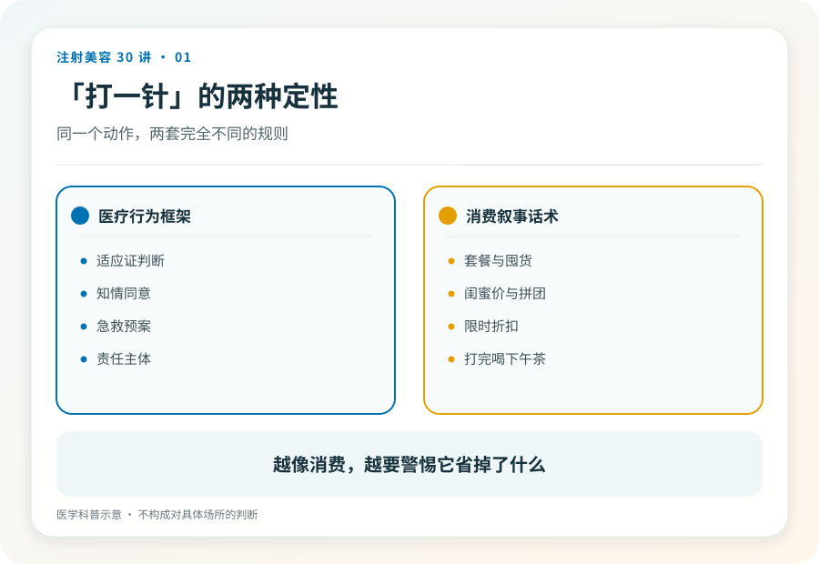
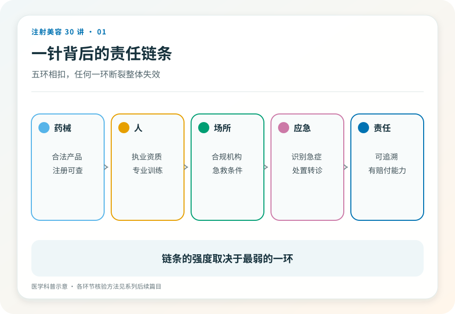

# 注射美容 01｜注射美容究竟是什么，你以为在消费，其实在接受医疗

> **视角｜消费者认知起点** 本文帮助你重新给“打一针”定性。它不评价任何具体项目，也不替你决定打还是不打。

“姐妹推荐的工作室，环境跟咖啡馆一样，打完水光还能喝下午茶。”这类描述里的每一个细节都在传递同一个信息，这只是一次轻松的消费。

但在中国的法律框架里，往皮肤下注射药品或医疗器械属于医疗美容，是医疗行为。这个定性不是文字游戏，它决定了你有权得到什么、出事时能找谁。

## 消费叙事在掩盖什么

医疗行为自带四样东西，适应证判断（你适不适合做）、知情同意（风险有没有讲清）、急救预案（出事了怎么办）、责任主体（找谁负责）。

消费场景恰好省掉的就是这四样。套餐、囤货、闺蜜价、限时折扣，这些话术把一次需要医生判断的医疗决策，包装成一次拼手速的购物。一个场景越努力让你觉得“这只是消费”，越说明它在回避医疗行为对应的成本与责任。

## 一针背后的责任链条

一次可以被信任的注射，需要五个环节同时成立，合法的药品或器械、有资质的操作者、有资质的场所、出事时的应急能力、事后可追溯的责任主体。

本系列把它称为责任链条。链条的特点是，任何一环断裂，整体就失效。产品是真的，但打针的人没有执业资格，链条断了。医生是真的，但场所没有急救条件，链条也断了。

后面的文章会逐环拆解这条链，怎么核验产品（第 03、23 篇）、怎么核验人和机构（第 05 篇）、为什么场所本身就是安全的一部分（第 22 篇）。

## 为什么“熟人”不能替代链条

美容院熟人推荐“内部渠道”是最常见的入口。熟人关系提供的是情感信任，责任链条提供的是制度保障，两者不能互相替代。

熟人不会故意害你，但她既不能替你判断适应证，也不能在血管栓塞发生的那几分钟里救你，更不能在出事后成为有赔付能力的责任主体。信任一个人，和信任一套系统，是两回事。

## 已经打过了怎么办

如果你已经在非医疗场所注射过，且出现了红肿、疼痛、硬结等不适，应尽快到正规医疗机构就诊，如实告知注射时间、部位与来源。医生需要这些信息判断风险，不会也不应成为指责你的理由。

同时保留付款记录、聊天记录和一切凭证。目前没有不适的，也建议把注射信息记录下来，它从注射那天起就是你病史的一部分。

## 证据边界

医疗美容的法律边界以监管部门当前规定为准，具体机构与人员资质要求可能随政策调整。本文给出的是定性框架，不构成对任何具体场所或项目的判断。

延伸阅读

- [国家卫健委医疗美容服务管理相关文件](https://www.nhc.gov.cn/wjw/c100221/202201/d7e8fa33a26b425da98d69fb04191699.shtml)
- [FDA 已批准皮肤填充剂](https://www.fda.gov/medical-devices/aesthetic-cosmetic-devices/fda-approved-dermal-fillers)

**你付的钱里，最贵的部分应该是出事时有人负责。如果价格里看不到这一项，它就真的不在。**
