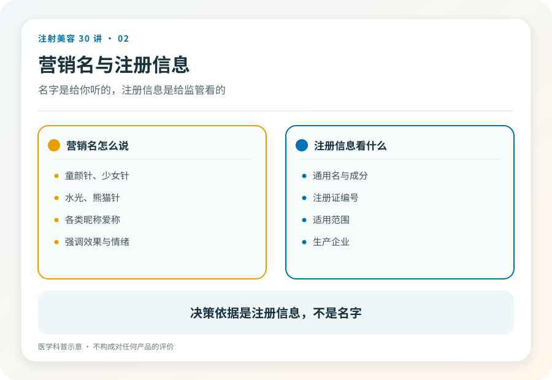
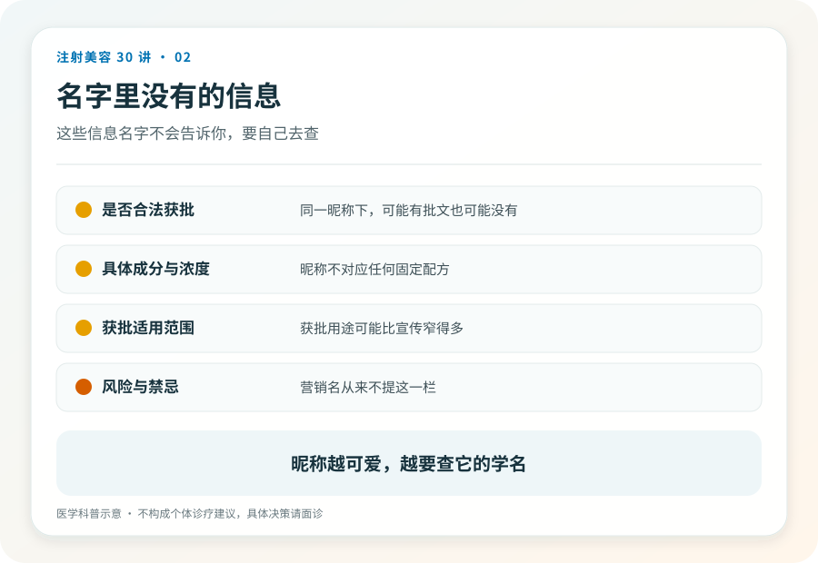

# 注射美容 02｜针剂的名字不会告诉你打的是什么

> **视角｜消费者认知起点** 本文不评价任何品牌，只教你把营销名翻译成可核验的注册信息。

童颜针、少女针、熊猫针、水光针、嗨体式的昵称……市面上的针剂名字越来越像奶茶菜单。很多人以为选注射项目就是在这些名字之间做选择。

问题在于，这些名字既不是药品名，也不是器械名。它们是营销语言，法律上不存在一个叫“童颜针”的产品。同一个营销名下面，可能对应完全不同的材料；“水光针”甚至可能不是一支产品，而是一类操作。

## 名字游戏的商业动机

营销名的好处全在卖方，它回避了注册信息的严肃性，让医疗产品听起来像美妆新品；它制造品类感和稀缺感，“最新一代少女针”比一串化学名好卖得多；它还方便换壳，当某个名字口碑变差，换个昵称重新上市即可。

对买方，营销名只提供一种功能，让你以为自己已经知道要打什么了。

## 把名字翻译回注册信息

做决策前，需要完成一条翻译链，营销名 → 注册产品名 → 材料类别 → 注册证编号。

比如听到“童颜针”，你需要知道的是，这支产品在药监局注册的名称是什么？材料属于哪一类（透明质酸类、聚左旋乳酸类，还是别的）？注册证编号是多少，能不能当场查到？

这条翻译链的每一环都是可核验的硬信息。翻译不出来的部分，就是你不该为之付钱的部分。

## 面诊时只需要一句话

“这支产品的注册证名称和编号是什么？我可以拍照吗？”

正规机构对这个问题习以为常，产品信息本来就应该展示。真正值得警惕的是那些含糊的回答，“进口的，国内还没上市”“医院内部渠道”“海外版效果更好”。

在中国合法注射的前提是在中国注册。查不到注册证的产品，“海外正品”与否没有意义。这不是渠道优势，是红牌信号，你可以直接离开。

## 记住类别，忘掉名字

本系列后面的文章会按材料类别展开，肉毒毒素（第 06–11 篇）、透明质酸填充剂（第 12–15 篇）、再生类材料（第 16–17 篇）。读完你会发现，理解几个材料类别，比记住几十个营销名有用得多。

名字每年都在换，材料类别和它们的风险结构是稳定的。

## 证据边界

产品注册状态随时间变化，任何具体产品的身份都应在决策当时通过官方渠道查询，本文不对任何在售产品做认定。

延伸阅读

- [国家药监局数据查询](https://www.nmpa.gov.cn/)
- [FDA 已批准皮肤填充剂](https://www.fda.gov/medical-devices/aesthetic-cosmetic-devices/fda-approved-dermal-fillers)

**名字是给你听的，注册证是给监管看的；做决定时，请只相信给监管看的那一份。**
