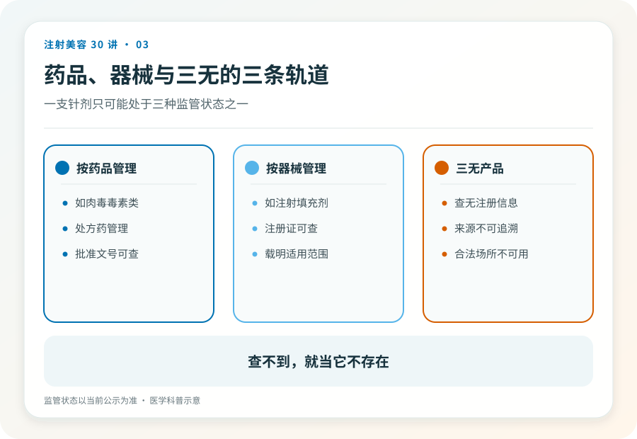
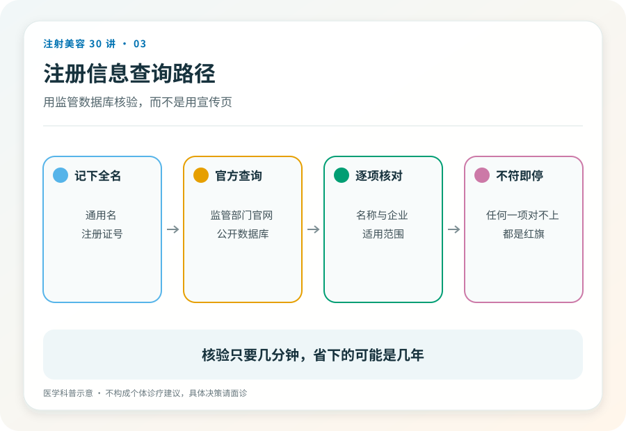

# 注射美容 03｜药品、器械与三无，一支针剂只有两种合法身份

> **视角｜消费者认知起点** 本文教你在“正品还是假货”之前，先问一个更基础的问题。

拿到一支针剂，多数人的第一反应是“这是正品吗”。但正品假货之争有一个前提，这个东西得先有一个合法的注射身份。

在中国，能合法注射进人体的产品只有两种身份，注册的药品（比如肉毒毒素，按处方药管理），或注册的医疗器械（比如多数填充剂）。查不到注册证的第三种东西，无论包装多精致、故事多动人，都是“三无”。对三无产品讨论真假没有意义。它连被造假的资格都没有。

## 三条轨道，一目了然

药品轨，需要药品注册，处方药还需要医生处方，肉毒毒素在这条轨上。

器械轨，需要医疗器械注册，透明质酸填充剂、再生类材料多在这条轨上。

三无轨，以上两个数据库都查不到。它可能是走私品、假货、实验室产物，或者根本不该被注射的东西。

有一个反直觉的细节值得单独说，身份跟随使用方式改变。某些成分以化妆品身份存在时是合法的，一旦被抽进注射器打进皮肤，就越界了。“这个成分本身没问题”不能为“注射这个成分”辩护。

## “海外正品”话术拆解

水货针剂最常见的辩护是，在原产国是合法产品，只是没走进口流程。

这个辩护有两处断裂。第一，在原产国合法不等于在中国可注射，注册审查不是形式，它包含针对本地人群的安全性评估。第二，即使水货是真品，它也脱离了冷链与追溯体系；生物制品对储运条件敏感，一支在后备箱里颠簸过夏天的“正品”，和假货的风险可能没有本质区别。

假货的反义词不是正品，是可追溯，从工厂到你的皮肤，每一环都查得到。

## 自己动手查，两分钟

国家药监局官网提供公开的数据查询入口，药品和医疗器械都能按名称或注册证编号检索。面诊时让机构出示产品注册信息，当场用手机查询比对。

查询是消费者唯一不依赖任何人的自保动作。它不需要医学知识，不需要人脉，不需要经验，只需要你愿意花两分钟。具体的当场核验动作清单，见第 23 篇。

## 已经打了来源不明的产品怎么办

不要等出问题再处理。先到正规医疗机构就诊记录在案，说明注射时间与部位；保留剩余包装、批号照片与付款凭证。

无症状不等于安全，非法针剂的伤害可能有延迟性（第 17、21 篇会展开）。越早建档，未来无论就医还是维权都越主动。

## 证据边界

产品注册状态是动态信息，本文写作时的查询路径与分类框架可能随监管调整，使用时以官方网站当前版本为准。

延伸阅读

- [国家药监局数据查询](https://www.nmpa.gov.cn/)
- [国家卫健委医疗美容服务管理相关文件](https://www.nhc.gov.cn/wjw/c100221/202201/d7e8fa33a26b425da98d69fb04191699.shtml)

**一支针剂在监管数据库里没有名字，它的风险就没有上限。**
