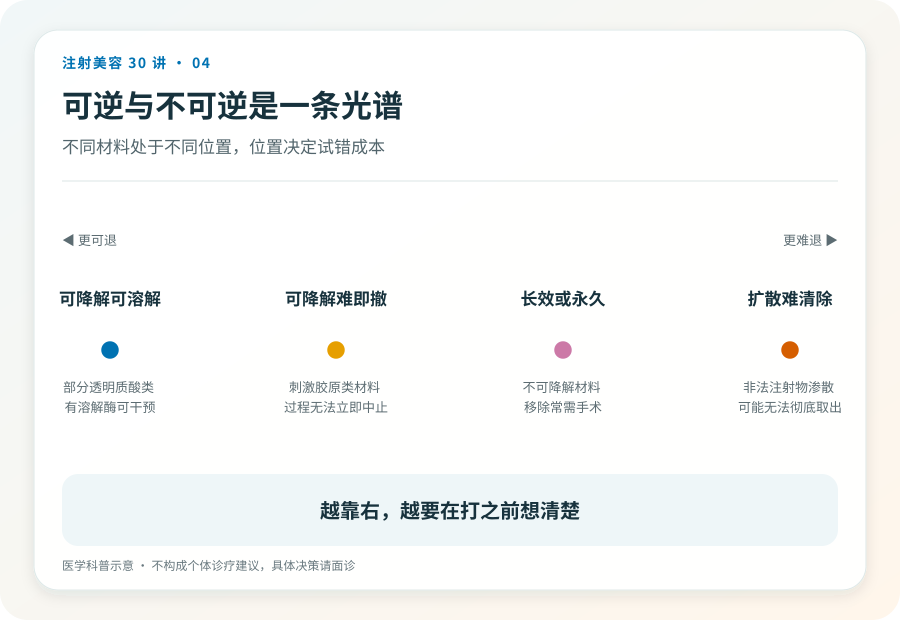
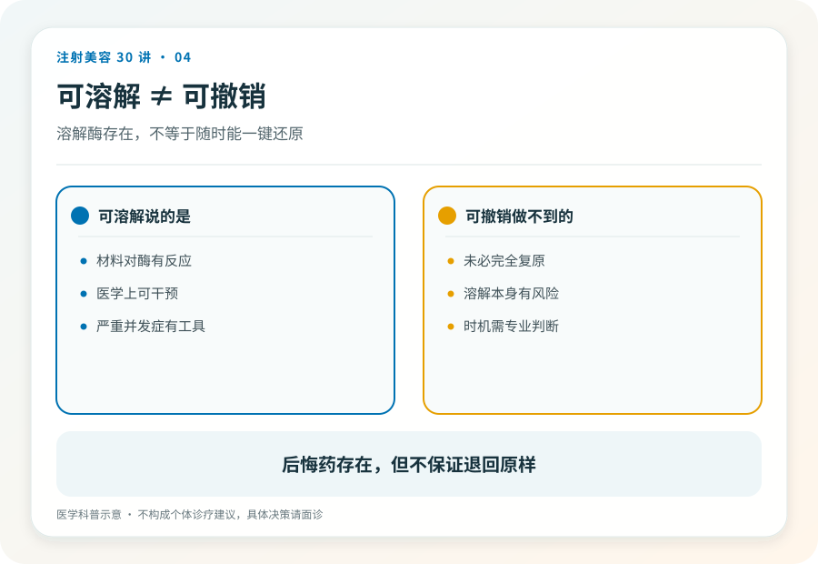

# 注射美容 04｜可逆与不可逆，注射美容最重要的一条分界线

> **视角｜消费者认知起点** 本文提供一个风险分层框架。“可逆优先”是本系列明确倡导的立场，不是医学指南结论。

“打坏了能恢复吗？”这是注射美容里最值得先问的问题，却往往排在“能维持多久”之后。

材料能否被降解或代谢，是注射美容风险等级的第一分界线。同样是“效果不理想”，可逆材料给你留了退路，不可逆材料让你和这个结果长期共处。

## 一条光谱，四个区间

把常见注射材料按“退出难度”排成一条光谱。

肉毒毒素，作用随时间自行消退，数月内神经功能逐渐恢复，不需要额外干预就会“退出”。

多数透明质酸填充剂，可以被溶解酶降解，有一个主动撤销的手段（但有前提，见下文和第 15 篇）。

再生类材料（聚左旋乳酸、聚己内酯类），材料本身缓慢降解，但它诱导生成的胶原组织没有溶解手段，过程一旦启动就不可叫停。

永久性与非法材料（如奥美定），不降解、可能迁移，只能手术取出，且往往难以取干净。

第一次尝试从可逆材料开始，是普通人能做的最重要的风险控制。对不可逆材料，决策标准应该向手术级别看齐，更长的考虑期、更充分的面诊、更保守的方案。

## “可逆”有三层含义，别混着用

会自行代谢、有特效降解手段、只能手术取出。这三者完全不同，但在营销语境里常被混成一句“不满意可以处理”。

面诊时值得把这个问题问细，“如果我后悔了，这个材料怎么退出我的身体？是等它自己代谢，还是有办法溶解，还是需要手术？”回答的具体程度，能看出对方是否诚实。

## 可溶解不等于可撤销

这是本系列反复出现的一个概念，第一次在这里讲清楚。

溶解酶能降解透明质酸材料，但它撤销不了已经发生的伤害。如果材料进入血管造成了栓塞，组织缺血坏死有自己的时间线，溶解只是抢救的一部分，不是时光倒流（第 14、15 篇展开）。同样，过度填充撑松的皮肤，材料溶掉后松弛仍在。

“可溶解”降低的是决策错误的成本，不是操作事故的成本。它不该成为你在产品、机构、医生上放松核验的理由。

## 体内已有“历史注射物”的读者

如果多年前注射过来源不明的材料，现在出现变硬、移位、反复红肿，就到有修复经验的正规医疗机构评估。不要在原机构“免费修复”的话术里打转，修复方案应该来自与原操作无利益关系的判断。

## 证据边界

各类材料的降解特性来自产品注册资料与文献共识，但个体差异真实存在，“可逆”不等于“在你身上一定完全复原”。本文不提供溶解操作的任何具体方法。

延伸阅读

- [Woodward 2015 面部填充并发症综述](https://pubmed.ncbi.nlm.nih.gov/26505541/)
- [FDA 已批准皮肤填充剂（可吸收/不可吸收分类）](https://www.fda.gov/medical-devices/aesthetic-cosmetic-devices/fda-approved-dermal-fillers)

**问“效果能维持多久”之前，先问“后悔了怎么退出”；退出机制的质量，才是一个项目的真实门槛。**
