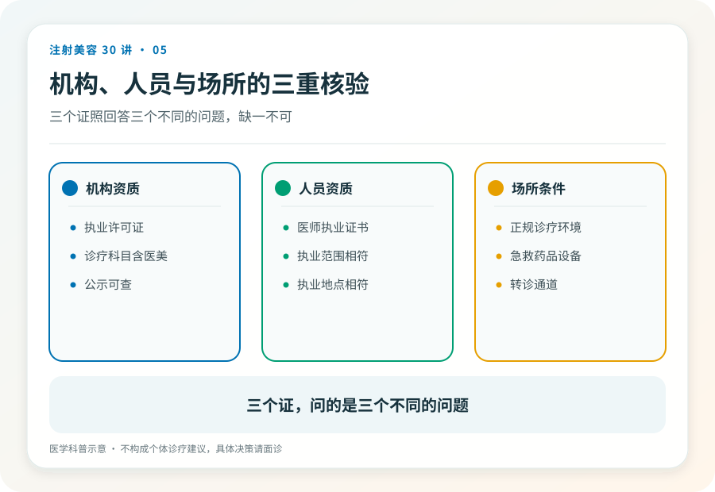
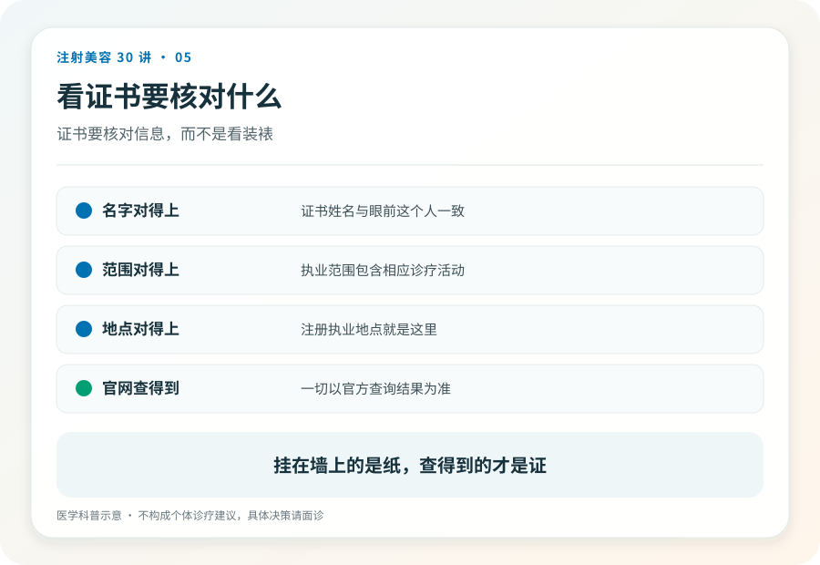

# 注射美容 05｜谁有资格给你打针，机构、医生、场所的三重核验

> **视角｜消费者认知起点** 本文教你核验资质，不教你分辨“手法好坏”。前者查得出来，后者查不出来。

“她是护士出身，打了十年了，比小医院的医生手法还好。”这句话几乎是非法注射场景的标准台词。它把一个资质问题偷换成了熟练度问题。

一次合法的美容注射需要三重资质同时成立，机构持有《医疗机构执业许可证》且诊疗科目包含医疗美容相应项目；操作者是注册在该机构的执业医师，或在医师指导下执行允许环节的护士；场所具备与项目风险匹配的急救条件。

“打了十年”不在这三重里的任何一重。

## 熟练度解决不了的事

熟练度解决的是常见情况，进针更稳、淤青更少、形态更顺手。资质体系解决的是罕见但致命的情况。

血管栓塞发生时（第 14 篇），需要的是即刻识别、急救药械、转诊通道。这些全部长在机构和场所上，不长在任何人的手上。一个脱离了正规体系的“老手”，在那几分钟里和你一样无助，而且比你更有动机拖延送医。

## 三张证，逐一核验

机构资质，《医疗机构执业许可证》应在场所公示，注意核对诊疗科目里是否包含医疗美容及相应项目类别，以及许可证上的地址是否就是你所在的地址；异地挂证的“分店”不在许可范围内。

人员资质，执业医师注册信息可在卫生健康部门官方平台查询，核对姓名、执业地点、执业范围。关键动作是确认“面诊的人”和“操作的人”是同一个人，并且就是注册信息里的那个人。

场所条件，这一重最难由消费者直接验证，但可以问（第 25 篇的面诊清单会覆盖）。有没有急救设备和药品？出现血管并发症怎么处理？和哪家医院有转诊通道？

## 值得警惕的两种影子

“挂证”，证是真的，人不在场，实际操作的是无资质人员。识别方法就是上一节的关键动作，让操作者本人出示本人的执业信息。

“飞刀”，外请医生到无资质场所操作。医生资质可能是真的，但场所这一重断了，链条照样失效。合法的多点执业有其规范路径，落脚点仍然是“机构与场所本身有资质”。

## 资质保证的是什么

需要诚实地说，三重资质核验通过，不保证审美合你的意，也不把风险降为零。它保证的是概率和底线，适应证有人把关、出事时有急救体系、事后有可追责的主体。

这是两类完全不同的筛选。先用资质筛掉不合法的，再用面诊（第 25 篇）去判断合不合适。顺序不能反，因为第二类判断只有在第一类通过后才有意义。

## 已经在无资质场所注射过的读者

无论目前有无症状，记录注射信息并保留证据。出现持续疼痛、皮肤发白、视力变化，立即急诊并主动告知注射史；此刻健康优先于一切，不要因为场所违规而回避就医。

## 证据边界

资质要求与查询渠道以卫生健康部门当前规定为准，不同项目类别对机构级别的要求可能不同，本文提供的是核验框架而非法规原文。

延伸阅读

- [国家卫健委医疗美容服务管理相关文件](https://www.nhc.gov.cn/wjw/c100221/202201/d7e8fa33a26b425da98d69fb04191699.shtml)

**技术好坏你未必看得出来，但证照真假你查得出来；把力气花在查得出来的事情上。**
