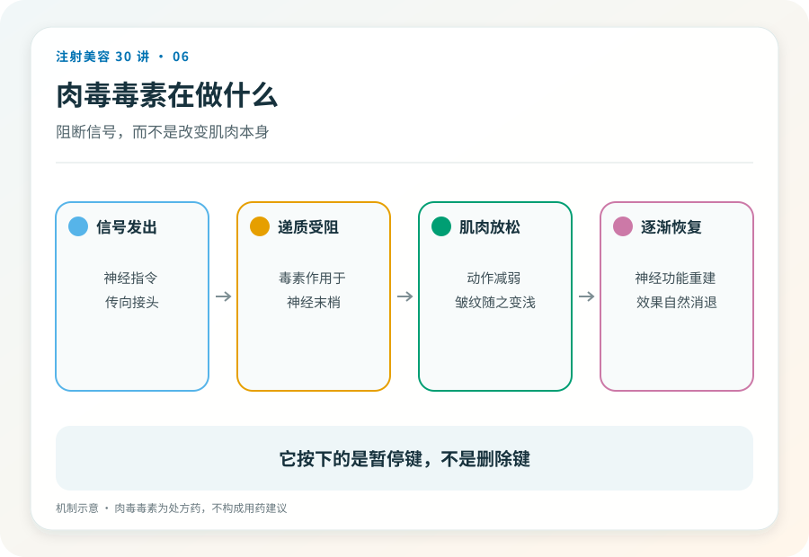
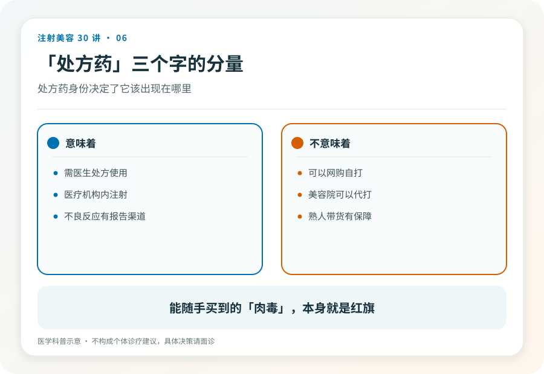

# 注射美容 06｜肉毒毒素是什么，不是毒药，也不是护肤品

> **视角｜消费者认知起点** 本文解释肉毒毒素的基本原理与药品身份，不讨论剂量、点位或品牌。

关于肉毒毒素，市面上流行两个相反的故事。一个说“那是世界上最毒的毒素，打进脸里迟早出事”；另一个说“就是个放松剂，午休打一针，打着玩”。

两个故事都在让你远离正确的决策框架。肉毒毒素是严格管理的处方药，微量、局部使用时能暂时阻断神经对肌肉的指令。这既是它起效的原理，也是它必须被当成药品对待的原因。

## 信号中断的工作原理

肌肉收缩需要神经末梢释放信号。肉毒毒素的作用是暂时阻断这个信号的传递；神经还在、肌肉还在，只是命令送不到了。

被阻断的肌肉放松下来，由肌肉反复收缩形成的动态皱纹随之变浅。随着神经末梢功能在数月内逐渐恢复，作用自然消退。这个“自动退出”的特性，让它在第 04 篇的可逆光谱上处于最可逆的一端。

## 剂量与场景决定属性

“世界上最毒的毒素”这个说法有其毒理学来源，但它描述的是另一个世界。食物中毒、大剂量系统暴露。医疗使用的是极微量、高纯度、局部注射的制剂，两者的差别是剂量、纯度和给药方式的差别。

这不是在为“安全”背书，而是在解释为什么它是处方药。正因为它是一种强效的生物制剂，它的每一次使用都需要医生判断适应证、控制剂量、管理风险。毒性叙事和玩具叙事，错的方式不同，结论相同，都是取消了医生这个角色。

## 处方药身份意味着什么

在中国，肉毒毒素按药品管理，有明确的批准适应证，美容使用同样要求在有资质的医疗机构由执业医师操作。

处方药的含义是，需要医生判断你是否适合，而不是你想要就能买。反过来，任何“不需要面诊、加微信下单、上门注射”的肉毒渠道，从药品管理的角度就已经全线违规。产品来源、储运条件、操作资质，一个都经不起追问。

## 犹豫本身值得尊重

如果你对“毒”字仍有强烈的心理障碍，不必说服自己。注射美容是择期项目，可以无限期推迟，可以永远不做。

比起“克服恐惧”，更有价值的是把恐惧转化成具体的问题清单，带去面诊。它是什么、怎么代谢、我的情况适不适合、出现问题怎么办。后面几篇会帮你把这些问题准备好。

## 证据边界

本文只讨论作用原理与药品身份，不涉及任何具体产品的比较。肉毒毒素的批准适应证以药监部门当前公示为准。

延伸阅读

- [Ho 2022 BoNT-A 国际多学科共识](https://pubmed.ncbi.nlm.nih.gov/35747253/)
- [国家药监局数据查询](https://www.nmpa.gov.cn/)

**它不可怕也不好玩。它是一支需要医生签字的药，这个定位本身就是对你的保护。**
