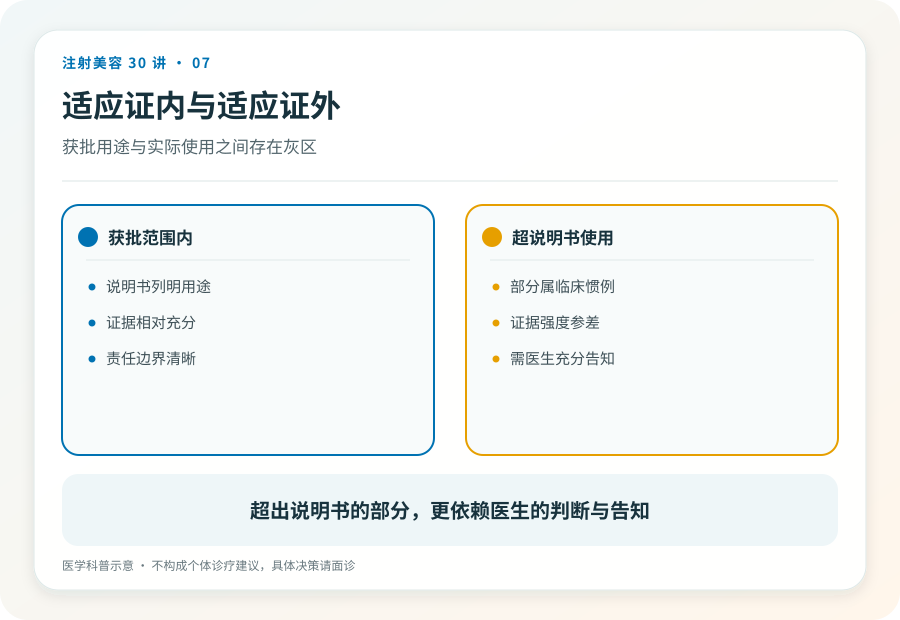

# 注射美容 07｜肉毒能做什么、不能做什么

> **视角｜消费者决策工具** 本文给你一把判断尺，不给项目推荐。个体适应证判断永远属于面诊。

抬头纹、法令纹、瘦脸、瘦肩、多汗、提升、紧致……肉毒的宣传清单覆盖了半张脸加半个身体。哪些有依据，哪些是外推？

判断工具其实只有一句话，肉毒的全部能力是让肌肉放松，所以它只对“肌肉活动造成的问题”有据可依。看到任何宣传，先问一个问题，这个问题是肌肉造成的吗？

## 先学会分辨两种皱纹

对着镜子做表情，皱眉、抬眉、大笑。表情时出现或明显加深的纹路，是动态纹，背后是肌肉收缩，属于肉毒有据可依的领域。

面部完全放松时依然清晰存在的纹路，是静态纹。它是皮肤本身的折痕和结构变化，让肌肉放松对它作用有限。多年动态纹反复折叠后往往会沉淀出静态成分，这就是为什么同一条纹路，肉毒可能只解决它的一部分。

这个自测不能替代面诊，但足以帮你过滤掉一大半夸大宣传。

## 三个常见场景的边界

皱纹，对肌肉收缩形成的动态纹有较充分的依据；对深的静态纹，单靠肉毒改善有限，医生可能会讨论其他工具。

瘦脸，肉毒针对的是咬肌肥大，肌肉体积大造成的下面部宽。如果脸宽来自骨骼形态或脂肪堆积，放松肌肉不解决问题。这就是为什么正规面诊会先触诊咬肌，让你咬紧牙判断肌肉份量，而不是直接报价。

多汗，腋下多汗症等有医学依据，但这属于医疗问题，应当走正规就诊路径评估，而不是美容套餐里的加购项。

## 超适应证使用意味着什么

批准适应证之外，存在一些有较多证据积累、临床上被讨论的用途，也存在大量纯营销外推。两者的边界，普通消费者难以自行判断，但可以记住原则，超适应证使用对医生的证据依据、知情告知和责任承担都有更高要求。它应该是医生郑重其事向你解释的事情，而不是价目表上的普通一行。

无效场景有个共同特征，把“肌肉放松”外推成“紧致”“提升”“变小”“年轻化”。听到这类词，回到那把判断尺。

## 面诊的正确顺序

可信的面诊先判断成因，再谈方案，你的困扰是什么、它是不是肌肉造成的、肉毒能解决其中哪部分、剩下的部分怎么办。

顺序反过来的面诊，先推项目再找理由。无论话术多流畅，都值得警惕。分不清自己的问题是不是肌肉造成的很正常，这正是面诊存在的意义；按短视频自我诊断后直接下单，才是真正的风险行为。

## 证据边界

各用途的证据强度差异很大，本文只给判断框架，不对具体部位的效果做承诺。批准适应证范围以药监部门当前公示为准。

延伸阅读

- [Ho 2022 BoNT-A 国际多学科共识](https://pubmed.ncbi.nlm.nih.gov/35747253/)
- [国家药监局数据查询](https://www.nmpa.gov.cn/)

**肉毒只会一件事，让肌肉安静下来。所有它做不到的承诺，都是把这一件事吹成了十件。**
