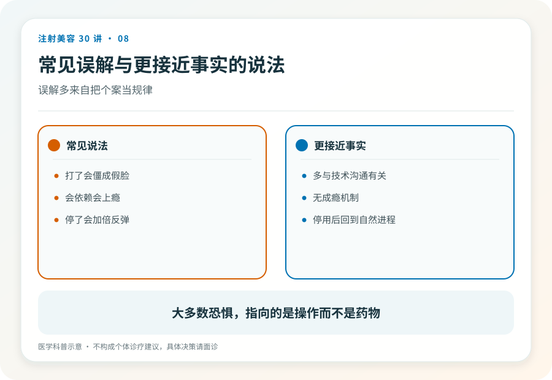
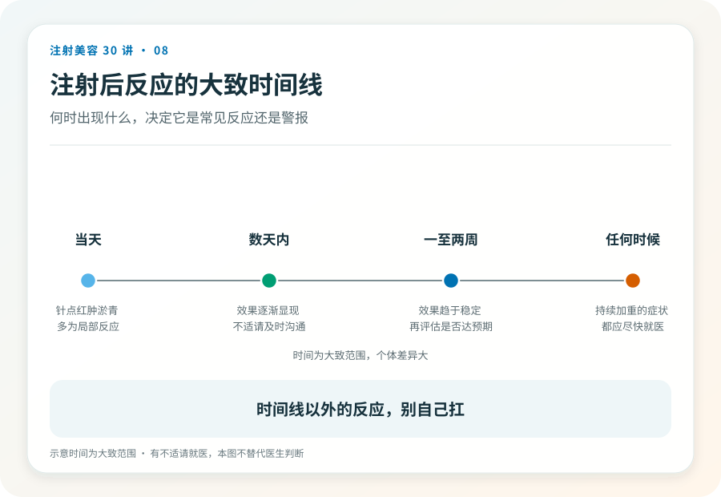

# 注射美容 08｜肉毒的真实风险与常见误解

> **视角｜消费者风险校准** 本文重排你的恐惧清单。“会恢复”不等于“没关系”，“罕见”不等于“不存在”。

“会不会中毒？会不会脸垮？会不会笑不出来？”问出这些问题的人，恐惧清单往往是乱序的，最担心的未必是最该担心的。

先给结论，正规使用下，肉毒的多数不良反应是局部、暂时的；真正该排在恐惧清单第一位的，不是“中毒”，而是非正规产品与非正规注射，因为那里的剂量、纯度、位置全部失控。

## 局部不良反应的机制与时限

注射后可能出现淤青、肿胀、注射点酸胀，通常短期内消退。

更让人担心的一类是“表情出错”，眼睑下垂、眉形怪异、笑容不对称。它的机制是药物扩散到了邻近肌肉，该放松的没放松够，不该放松的被放松了。

这类反应的关键属性是时限性，随着药效消退，功能会恢复。这是肉毒作为可逆材料的兜底价值。但“会恢复”意味着你可能要与一个不满意的表情共处一段时间，这个成本应该在决策时就知道，而不是发生后被一句“过几个月就好了”安抚。

## “脸垮”是怎么回事

咬肌注射后，有人照镜子觉得“脸垮了”。需要拆开看，咬肌体积缩小后，面部轮廓和软组织的视觉关系会变化，这种改变与“组织下垂”不是一回事；同时，对新面孔的心理适应期真实存在。

至于长期反复注射下咬肌的变化是否完全可逆，证据并不完整。这是一个应该在面诊时和医生讨论的不确定性，而不是宣传页上的保证项。

## 系统性风险的真实位置

正规剂量的美容注射，系统性中毒极为罕见。文献中的严重事件多与假药、超大剂量、非法操作相关。

这个事实的正确用法不是“所以放心打”，而是把防范力量投向正确的对象，产品真伪（第 03、23 篇）、操作资质（第 05 篇）、场所条件（第 22 篇）。你对抗风险的武器不是运气，是核验。

## 哪些情况必须就医

注射后出现吞咽困难、声音改变、全身乏力、呼吸费力。这些提示药物影响超出局部范围，属于急症，立即就医并告知肉毒注射史。

眼睑沉重、表情不对称虽多为暂时，也应回访注射医生记录在案。一方面排除其他问题，另一方面这些信息会改进你下一次的方案（如果还有下一次）。

任何拿不准且在加重的情况，就医永远不算过度反应。

## 证据边界

不良反应的发生率因产品、部位、操作差异很大，本文不给出具体数字，也不提供任何“出现问题自行处理”的方法。

延伸阅读

- [Ho 2022 BoNT-A 国际多学科共识](https://pubmed.ncbi.nlm.nih.gov/35747253/)
- [Woodward 2015 面部注射并发症综述](https://pubmed.ncbi.nlm.nih.gov/26505541/)

**正规注射的副作用大多会过去，非正规注射的问题在于。你连“会过去”这个保证都没有。**
