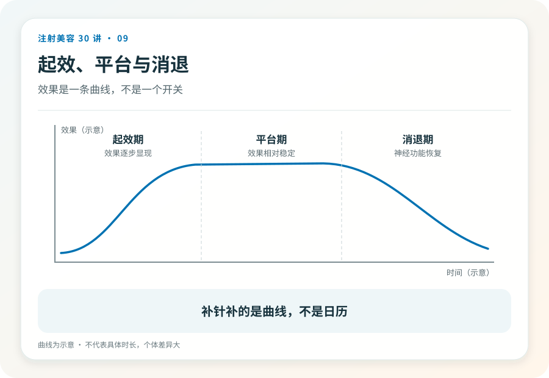

# 注射美容 09｜起效、维持与补针的时间逻辑

> **视角｜消费者决策工具** 本文讲时间形态，不给时间表。任何精确到周的承诺都值得怀疑。

“打完三天没效果，是不是假药？”“维持多久算正常？”“多久补一次最划算？”

这三个问题背后是同一个期待，一张精确的时刻表。而市场很乐意给你一张，然后按这张表卖套餐。

## 时间形态，而不是时间表

肉毒的基本时间形态是三段，起效期（注射后数天内，神经信号逐渐被阻断，效果逐步显现）、平台期（效果相对稳定的数月）、消退期（神经末梢功能恢复，作用渐渐减弱）。

具体到个人的时长，受剂量、部位、肌肉力量和个体差异影响，同一个人不同部位、不同次数之间都可能不同。“区间＋个体差异”是诚实表述的上限，任何把它压缩成精确数字的说法，都是在用确定性换取你的下单速度。

## 两个常见焦虑，两次校准

打完第二天没变化，不等于无效，起效本来就需要数天，急着在镜子前找变化只会制造焦虑。

反过来，一个多月就觉得“没了”，也未必是产品问题。对肌肉的抑制是渐进消退的，而人的观感受心理基线漂移影响。你已经习惯了放松后的样子，轻微的功能恢复就会被放大成“全没了”。对着注射前的照片比，而不是对着记忆比。

如果确实存在异常的快速失效，正确路径是带着记录就医评估（第 10 篇展开），而不是立刻加打。

## 套餐经济学如何把医学判断变成沉没成本

“三次一疗程，季卡更划算”，预售套餐的问题不在价格，在决策结构。它把“什么时候该补针”从医学判断变成了沉没成本管理。买了三次的人，会倾向于按周期打满三次，无论当时是否需要。

补针时机本该由两个因素决定，功能是否明显恢复、你是否仍然需要这个效果。它们都只能在当时评估，无法在收银台预判。

此外，过密的补针间隔与耐药风险的讨论相关（第 10、11 篇）；频繁暴露可能透支的是你未来的有效性。这让“囤针”从单纯的消费问题升级成了医学问题。

## 有用的记录习惯

每次注射留下四样信息，日期、产品注册名与批号、注射部位、注射前后的标准化照片（同角度、同光线、做表情与不做表情各一张）。

这份记录在三个场景里救你，评估效果时替代不可靠的记忆、疑似无应答时供医生判断、发生纠纷时作为证据。

## 证据边界

本文刻意不给出“正常维持 X 个月”的数字；不是没有文献区间，而是区间在营销语境里必然被念成承诺。你的时间形态，请与你的注射医生逐次校准。

延伸阅读

- [Ho 2022 BoNT-A 国际多学科共识（含注射频率与耐药讨论）](https://pubmed.ncbi.nlm.nih.gov/35747253/)

**生物没有会员制。你的神经末梢按自己的节奏恢复，不看你买了几次卡。**
