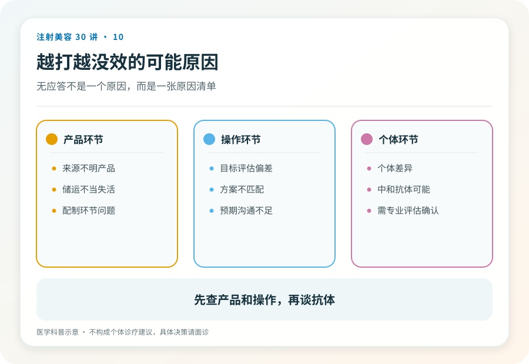
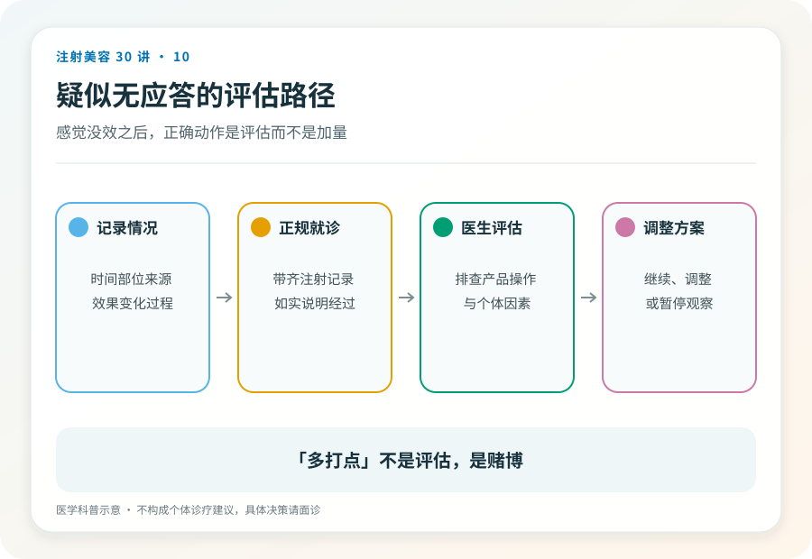

# 注射美容 10｜为什么越打越没效，关于“耐药”你该知道的

> **视角｜消费者风险校准** 本文帮你在“该换贵的了”这句话之前，先建立一个鉴别框架。

“以前打一次管半年，现在两个月就没效了。”老用户的这个困惑，在机构里最常得到的解释是，该换更贵的产品了。

先放结论，“越打越没效”有多种可能，真正的免疫性无应答只是其中之一；它真实存在、可能被低估，而它最主要的可控因素是注射频率与累积暴露，并非价格。

## 效果变差 ≠ 耐药

在考虑“耐药”之前，先过一遍更常见的解释。

记忆美化。第一次的惊艳感不可复制，后续每次都在和被美化的记忆比较。皱纹本身在进展，基线变差了，同样的效果看起来打了折扣。方案在变，不同医生、不同剂量、不同点位，效果本来就不可比。评估方式不标准，凭感觉和照镜子，不如标准化照片可靠。

这就是第 09 篇记录习惯的价值，没有记录，以上因素和真正的无应答混在一起，谁也分不清。

## 中和抗体与免疫系统的“通缉犯画像”

肉毒毒素是外来蛋白。免疫系统反复见到同一种外来蛋白后，可能学会识别它，产生中和抗体；相当于给它画了通缉犯画像，下次它一进来就被拦截中和，到不了神经末梢。

这就是免疫性继发无应答，以前有效，后来效果越来越弱直至消失。

证据现状需要如实交代，美容场景的耐药发生率可能被系统性低估；剂量小、随访不规律、缺乏标准检测，都让病例难以浮出水面。国际共识文件讨论的风险因素中，频繁注射、短间隔补针、高累积剂量位置靠前。这是一个证据仍在积累的领域，确定的数字没有，值得认真对待的信号有。

## 对你的实际含义

不为微小的不满意频繁补针。每一次“再补一点”都在增加累积暴露，而它透支的可能是你长期的选择权，包括一个多数人从没想过的场景。未来如果你因疾病需要肉毒治疗（某些神经科、康复科的适应证），已形成的抗体不区分你打它是为了美容还是治病。

“换个品牌解决耐药”的推销逻辑也要谨慎对待，不同制剂的免疫原性差异是学术上仍在争论的问题，把它当成确定的解决方案来卖，超出了证据的支撑范围。

## 疑似无应答，正确动作是什么

带上完整注射记录（时间、产品、剂量如果知道、机构）就医评估，让医生系统排查；先排除技术与评估因素，再讨论免疫因素。

不要做的，自行加量试错、频繁换机构反复打、在没有评估的情况下接受“加强套餐”。

没有记录本身就是一个教训。从现在开始，要求机构提供并自己保存每次的注射信息。

## 证据边界

本文不提供“打几次会耐药”的阈值。它不存在。免疫性无应答的个体风险无法预测，能做的是管理可控因素，频率、间隔、必要性。

延伸阅读

- [Ho 2022 BoNT-A 耐药国际多学科共识](https://pubmed.ncbi.nlm.nih.gov/35747253/)

**对肉毒最大的浪费不是打贵了，而是把未来的有效性提前透支在每一次“再补一点”上。**
