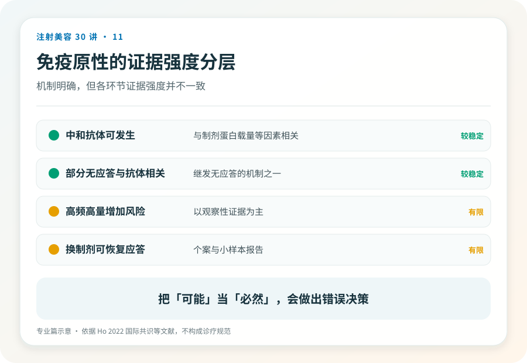
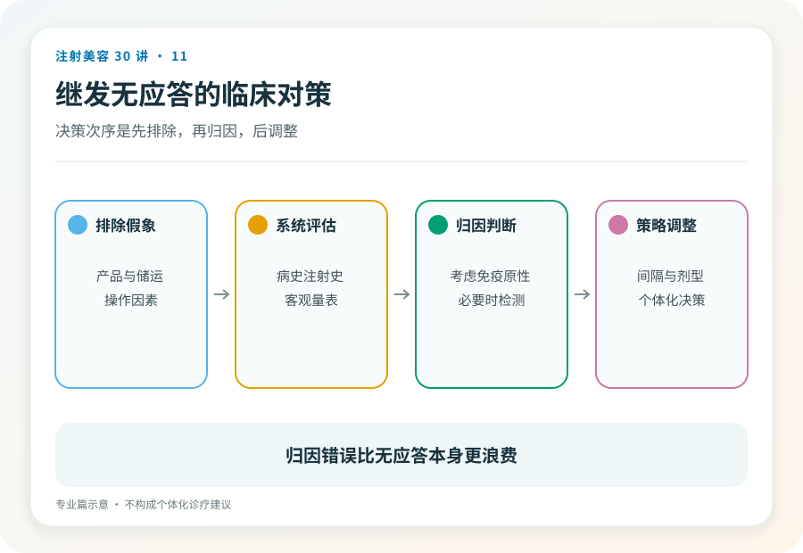

# 注射美容 11｜免疫原性与继发无应答的证据、评估与对策框架

> **视角｜从业者证据校准** 本篇面向专业读者，提供判断框架与评估流程，不提供剂量方案，不做品牌结论。

关于 BoNT-A 的免疫原性，从业者中流行两种相反的轻率。一种把所有效果衰减都归因于中和抗体，通常服务于升单；另一种断言美容剂量下不可能产生抗体，说的是“剂量那么小”。

两者都没有站在当前证据上。BoNT-A 的免疫原性是真实且可能被系统性低估的临床问题，美容场景的小剂量不构成豁免。

## 机制层｜抗体形成与临床无应答之间

中和抗体针对核心神经毒素蛋白的功能域，阻断其进入神经末梢的能力；针对复合蛋白的抗体则未必影响临床效果；抗体阳性与临床无应答不是同一件事，中间隔着滴度、表位特异性和个体差异。

这个区分有实际意义，它解释了为什么检测手段的选择影响“发生率”数字，也解释了为什么部分抗体阳性患者仍有应答。引用任何发生率数据前，先看它测的是什么。

## 证据层｜共识怎么说，数据缺口在哪

2022 年国际多学科共识的核心判断，美容人群的中和抗体数据有限、随访不系统，真实发生率很可能被低估；讨论中的风险因素包括短间隔注射、高累积剂量、既往治疗史。

需要标注证据强度的地方，风险因素多来自治疗性使用（大剂量适应证）的数据外推与专家意见，美容剂量下的前瞻性数据稀缺；不同制剂免疫原性差异的临床意义仍在争论，现有比较多受研究设计与利益关联的干扰。这正是本系列不做品牌结论的原因。

## 评估层｜继发无应答的鉴别流程

结构化流程比直觉可靠。

第一步，确认“无应答”本身，标准化照片对比、注射记录核对，排除评估偏差与基线进展。第二步，排除技术因素，剂量是否充分、点位是否合理、产品储运是否可靠，必要时由另一位有经验的医生独立评估。第三步，才进入免疫因素，床旁功能试验（如额肌试验）可提供线索，但其方法学局限应当明说。它是筛查工具，不是确诊工具。

跳过前两步直接归因抗体，和拒绝考虑抗体，是同一种懒惰的两个方向。

## 对策层｜保护患者的长期应答能力

框架性原则（不含参数），避免“补针文化”，对微小不满意保持克制；在满足临床目标的前提下管理累积暴露；维护完整治疗史记录并让患者持有副本；与患者沟通长期选择权，包括未来治疗性使用的场景，这在知情同意里几乎总是缺席的一块。

疑似免疫性无应答的患者，处置方向（暂停暴露、重新评估、必要时的检测路径）应个体化制定，本文不给通用方案。

## 行业层｜每个注射者都是数据链的一环

美容场景无应答上报的不完整，直接造成了本篇反复出现的“证据有限”。不良反应与无应答的记录、上报既是合规义务，也是这个领域走出数据贫困的唯一路径。你今天记录的病例，是明天共识的原材料。

## 证据边界

本篇的证据基础以国际共识与治疗性使用文献为主，美容剂量下的多数具体数字仍属推断区。扩写与再传播时，不应将共识意见升格为实证结论。

延伸阅读

- [Ho 2022 BoNT-A 耐药国际多学科共识](https://pubmed.ncbi.nlm.nih.gov/35747253/)

**每一针都在与患者的免疫系统对话。你今天的注射习惯，决定这场对话十年后还能不能继续。**
