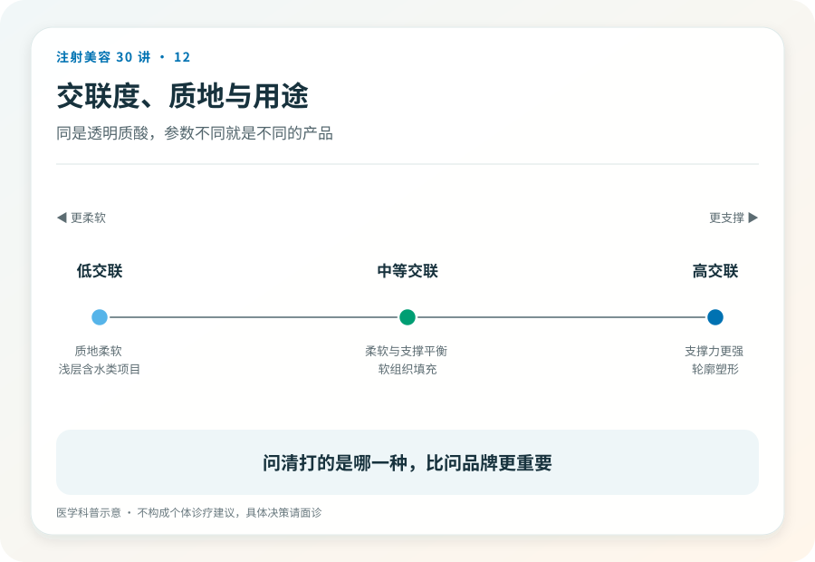
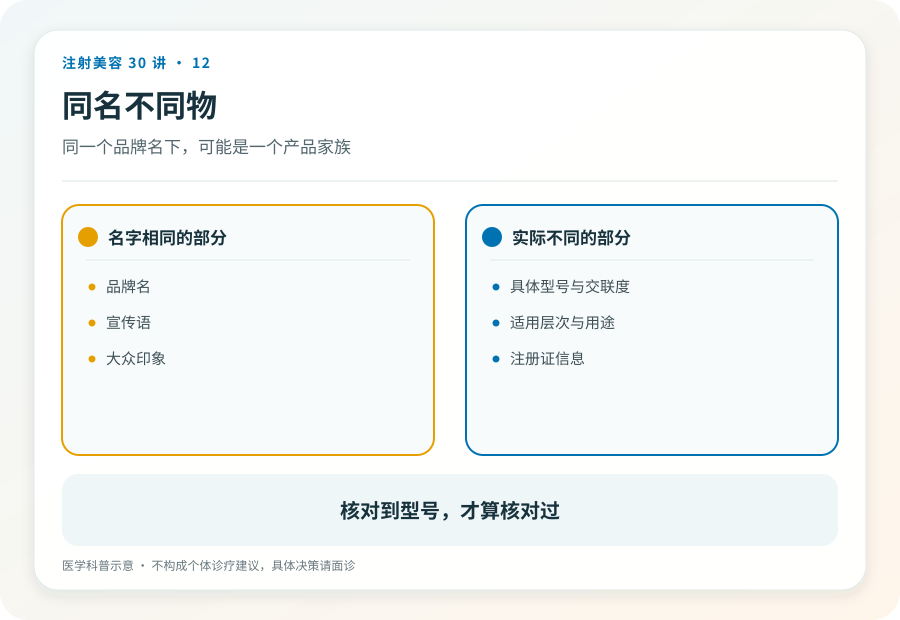

# 注射美容 12｜玻尿酸是什么，同一个名字下的一百种东西

> **视角｜消费者认知起点** 本文纠正“玻尿酸=保湿成分=温和安全”的推理链，不做产品选购指导。

“玻尿酸不就是保湿的吗？面膜里都有，打进去应该很安全吧。”

这句推理的每一步都踩在同一个陷阱上，“玻尿酸”这个词同时出现在面膜、口服液和注射针剂里，但它们不是同一个东西的不同用法，而是法律身份、纯度要求、风险等级完全不同的三类产品。

## 涂的、吃的、打的并非同一种东西

涂抹的透明质酸是化妆品成分，作用停留在皮肤表面的保湿。口服的属于食品或保健品范畴，本系列不展开。注射用的透明质酸填充剂，是按医疗器械注册管理的植入物。

第 03 篇讲过的原则在这里具体化了，身份跟随使用方式改变。同一个化学名，涂在脸上合法的东西，被抽进注射器就完全是另一回事；需要另一套注册、另一种纯度、另一个风险等级的管理。

## 交联如何把水变成果冻

天然的透明质酸在体内降解很快，直接注射几乎留不住。注射用填充剂通过交联工艺，把松散的分子链连接成网状；就像把一杯水做成一块果冻，让它能在组织里维持形态和体积。

交联度、颗粒特性、内聚性这些工程参数，决定了一款产品的“性格”。偏软的适合浅层和精细部位，支撑力强的用于需要塑形的深层部位。同一品牌下的不同型号，就是不同性格的不同工程。

这就是为什么“我朋友打了效果很好”无法平移到你身上；她打的具体型号、部位、层次、剂量，构成了一个不可复制的组合。

## “保湿成分所以温和”错在哪

注射的风险主要不来自成分名，而来自两处。第一是“注射”这个动作，任何被推入组织的材料都存在进入血管的可能（第 14 篇），这与材料多“天然”无关；第二是产品的合法性与质量，交联剂残留、纯度、无菌保障，全部依赖正规注册产品的质控体系。

换句话说，合规透明质酸填充剂的“温和”，是工程和监管的产物，不是“玻尿酸”三个字自带的属性。三无针剂借用这三个字的好名声，卖的却是没有任何质控的东西。

## 你需要带走的三件事

第一，决策对象是具体产品，不是成分名；面诊时问注册产品名，而不是“是不是玻尿酸”。第二，型号与用途的匹配是医生的专业判断，你的任务是核验产品合法性（第 23 篇）和医生资质（第 05 篇）。第三，无论产品多正规，注射后剧烈疼痛、皮肤发白或花斑、视力变化都是急症信号，立即就医（第 14、26 篇）。

## 证据边界

本文不比较任何品牌与型号。产品的注册信息、适用范围以药监局公示为准；“小分子/大分子”等宣传话术不在本文讨论框架内，因为它们不是注册信息中的规范表述。

延伸阅读

- [FDA 已批准皮肤填充剂](https://www.fda.gov/medical-devices/aesthetic-cosmetic-devices/fda-approved-dermal-fillers)
- [国家药监局数据查询](https://www.nmpa.gov.cn/)

**成分名是化学，产品是工程。你打进脸里的从来不是“玻尿酸”，而是某一个具体工程的全部细节。**
