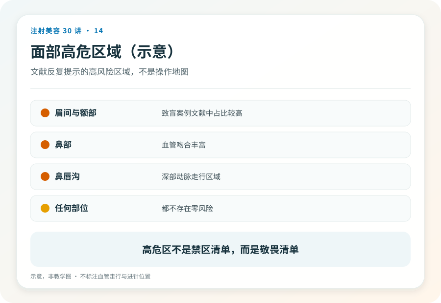
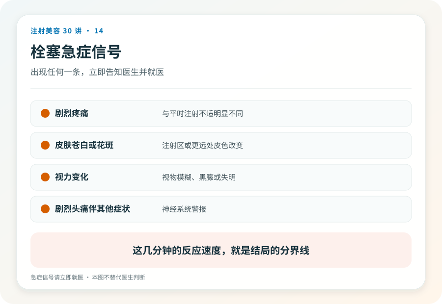

# 注射美容 14｜血管栓塞与失明是填充最重的风险，你必须知道

> **视角｜消费者知情底线** 这是本系列最沉重的一篇。写它不是吓退你，而是这件事常在知情同意里被一句带过。

“不就是打个玻尿酸吗，能出什么大事？”

能出的最大的事是，失明。还有皮肤坏死。这两件事发生的概率很低，但一旦发生，多数无法完全挽回。本系列认为，每一个考虑填充注射的人，都有权在付钱之前完整地知道这件事。它的存在，是你前面读到的所有核验动作的全部理由。

## 水管与阀门模型如何解释风险

面部血管像一套彼此连通的水管网络，并且与眼睛的供血通道相连。

填充材料如果被推入血管，会像异物堵住水管一样阻断供血。堵在皮肤的供血血管，对应区域缺血、坏死；材料顺着血流逆行进入眼部供血动脉，可能在极短时间内造成视力丧失。

这解释了为什么某些部位被称为高危区。眉间、鼻部、鼻唇沟、额部的血管解剖，让材料进入危险通道的概率更高。这也解释了为什么这个风险无法降为零，血管走行存在个体变异，再有经验的医生也无法透视你的血管。

## 文献告诉我们什么

对世界文献的回顾研究识别出约百例填充相关视力受损病例。高危部位以眉间、鼻部、鼻唇沟、额部为主；自体脂肪和透明质酸是最常涉及的材料；多数视力丧失未能恢复；没有任何一种抢救手段被证明稳定有效。

这些数字克制地说明了两件事，它相对于全球巨大的注射量很罕见，但又不可逆。这正是它值得用一整篇来写的原因。低概率乘以不可逆，风险权重仍然很高。

## 正规为什么仍然重要，但不等于零风险

既然无法降为零，核验还有什么意义？

正规体系的价值在两端，事前，训练有素的操作者了解危险区解剖、使用风险更低的操作方式，把概率压到最低；事后，栓塞的抢救以分钟和小时计（第 18 篇），正规机构有识别能力、急救药械和转诊通道。工作室连第一步“意识到发生了什么”都可能做不到。

同样重要的还有你的配合，如实告知既往注射史和手术史。疤痕与既往材料会改变局部解剖，这些信息直接影响医生的操作决策；隐瞒它们等于拆掉自己的一道防线。

## 请像记消防通道一样记住急症信号

注射过程中或注射后，出现以下任何一项，都是“立即”级别的急症。

剧烈疼痛，远超预期的痛；皮肤瞬间发白，或出现花斑样、网状的颜色改变；视力下降、视野缺损、眼前发黑；剧烈头痛、恶心呕吐。

正确动作只有三个，立即要求停止注射；立即就医（栓塞处置能力强的正规医疗机构）；明确告诉接诊医生“我刚接受了面部填充注射”。时间以分钟计，不要观察等待，不要“先回家看看”。

## 证据边界

本文引用的病例数据来自文献回顾，不能换算为任何具体机构、产品或操作方式的发生率。抢救手段的有效性证据有限且存在争议，这部分属于专业急救体系（第 18 篇），不构成任何自救指引。

延伸阅读

- [Beleznay 2015 填充剂致盲世界文献回顾](https://pubmed.ncbi.nlm.nih.gov/26356847/)
- [Woodward 2015 面部填充并发症综述](https://pubmed.ncbi.nlm.nih.gov/26505541/)

**知道最坏的可能，不是为了害怕，而是为了在那一刻你比周围所有人都清楚现在该做什么。**
