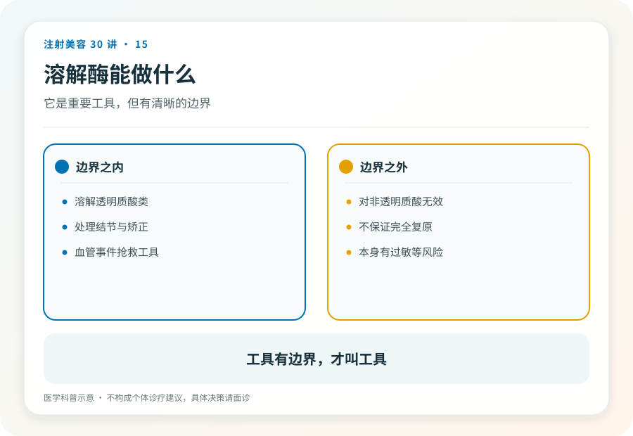
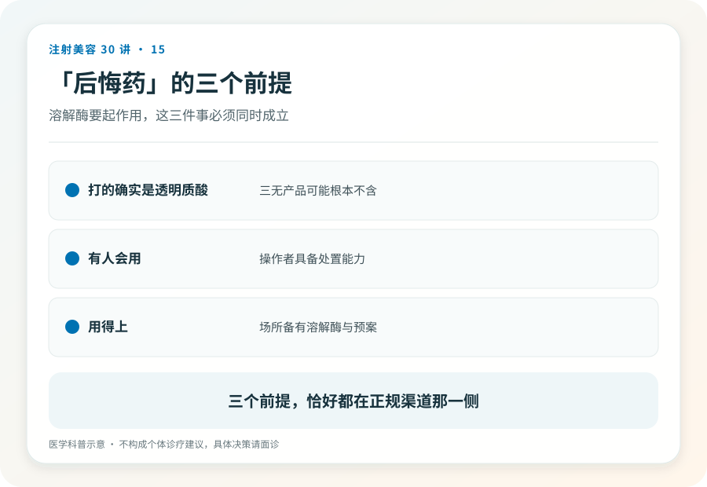

# 注射美容 15｜溶解酶是后悔药，但有三个前提

> **视角｜消费者风险校准** 本文校准“大不了溶掉重来”这句话的真实含义，不提供任何溶解操作的方法。

溶解酶（透明质酸酶）的存在，让很多人把透明质酸填充当成了可以无限撤销的操作。“大不了溶掉重来。”

这种安全感一半是真的，可降解性确实是透明质酸相对其他材料的真实优势，也是第 04 篇“第一次选可逆材料”建议的基础。另一半是危险的，“能溶”有三个前提，把它当成零成本的撤销键，会让你在前面所有决策上放松警惕。

## 前提一是打的真是透明质酸

溶解酶只降解透明质酸。这句废话在现实里不是废话，非法针剂冒充“玻尿酸”的情况真实存在，打进去的如果是别的东西，溶解酶不仅无效，连“先溶了看看”的评估路径都不成立。

这把我们带回第 03、23 篇，产品核验不是多余的仪式，它同时决定了你未来的退路是否存在。在无法核验产品的场所注射“玻尿酸”，等于亲手把后悔药换成了空盒子。

## 前提二是溶解本身属于医疗操作

溶解酶不是卸妆水。它本身是需要注射的药物，有过敏风险（包括严重过敏反应），需要评估、需要资质、需要应急能力；第 05 篇的三重资质，一条都不能少。

“美容院也能帮你溶”是双倍违规，非法场所进行的又一次非法注射。用违规手段撤销上一个违规决定，是把自己暴露在新一轮风险里。

网购溶解酶自行处理，则在此基础上再加一层，来源不明的药物、没有评估的剂量、没有急救预案的过敏风险。任何情况下都不要这么做。

## 前提三是可溶解不等于可撤销

第 04 篇提出的概念，在这里展开。

溶解酶降解的是材料，不是后果。血管栓塞造成的组织坏死，有自己的进程和时间线；溶解在栓塞抢救中确有角色，但那属于专业急救体系（第 18 篇）的一部分，且远非万能；过度填充撑松的皮肤，材料溶掉后松弛仍在；反复填充-溶解-再填充的循环，每一轮都是新的操作风险。

一句话，溶解酶降低的是“审美后悔”的成本，救不了“操作事故”的场。这两类问题，靠的是完全不同的防线。

## 想溶解，正确路径是什么

对填充结果不满意想溶解的读者，应回到正规医疗机构评估，最好找与原注射机构无利益关系的医生。

评估内容应包括，当初打的是什么（这就是注射档案的价值）、目前的问题是什么、溶解是否是最优解、溶解的预期与风险。不满意不一定需要立刻溶解，有些情况观察与等待代谢是更保守的选择。这个判断属于面诊。

## 证据边界

溶解酶在并发症管理中的具体用法、剂量与时机属于专业领域，文献中仍有争论，本文不做任何操作层面的描述。

延伸阅读

- [Woodward 2015 面部填充并发症综述（含溶解酶在并发症管理中的角色）](https://pubmed.ncbi.nlm.nih.gov/26505541/)

**真正的后悔药从来不是某支针剂，而是每一步都留有退路的决策方式；溶解酶只是其中最显眼的一步。**
