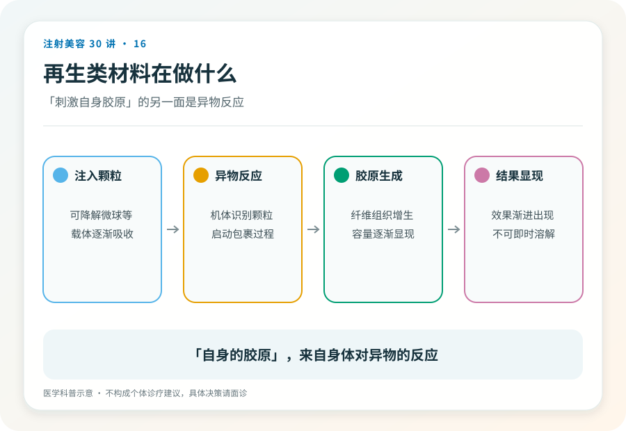
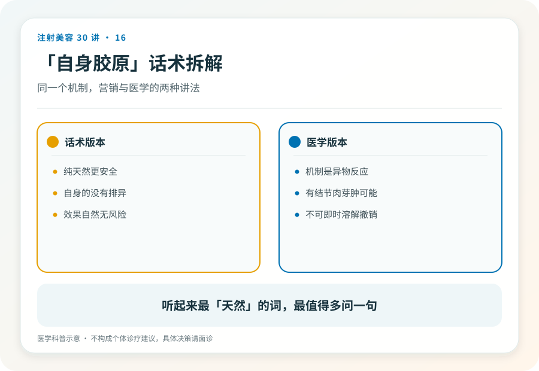

# 注射美容 16｜童颜针、少女针所谓“刺激自身胶原”到底意味着什么

> **视角｜消费者话术拆解** 本文翻译“再生”类营销语言，不比较品牌，不否定这类材料的合理使用场景。

“童颜针是刺激你自己长胶原，比玻尿酸更天然、更安全。”

这句话里，“自身的”“天然的”“再生的”构成了一组诱导词，读者顺着它们得出“更安全”的结论。方向完全反了，这类材料的特性恰恰要求比玻尿酸更谨慎的决策，而不是更轻松的。

## 把“刺激自身胶原”翻译成机制语言

再生类材料（聚左旋乳酸、聚己内酯等微球类产品）的工作方式是，把可缓慢降解的微球注入组织，身体把它们识别为异物，启动异物反应把它们包裹起来；胶原沉积就是这个包裹过程的产物。

所以，“自身胶原”是异物反应的产物，不是身体自发的青春再现。“自身”参与不改变“异物诱导”的本质，就像疤痕也是“自身组织”，但没人用它证明受伤是好事。

这不是说异物反应可怕。它是这类材料被设计出来的工作原理，在合规产品与合理使用下是被研究和管理的过程。要纠正的只是那条推理，“自身生成”不等于风险更低。

## 与玻尿酸的本质区别在于体积与过程

玻尿酸填充是“放进去一个体积”，效果即时可见，不满意可以溶解（第 15 篇的三前提之内）。

再生材料是“启动一个过程”，效果渐进出现、需要多次治疗、最终形态取决于你的身体如何响应，而这个响应存在个体差异。更关键的是，过程一旦启动，没有溶解酶这样的撤销键。生成的胶原组织会长期存在，它在第 04 篇可逆光谱上的位置，比多数人以为的要靠右得多。

这两个特性叠加的决策含义，“试试看”的成本比玻尿酸高得多。效果不可预览、结果不可叫停、不满意不可溶解。每一条都在提高决策门槛。

## 迟发问题在哪里

结节、肉芽肿等迟发反应（第 17 篇展开）在再生类材料的风险谱里位置更靠前；异物反应的强度个体差异大，少数人的包裹过程会走向过度或紊乱。

这类问题的处理比透明质酸相关问题更棘手，正因为没有降解手段。这再次指向同一个结论，材料越不可逆，前端的核验（产品、机构、医生、方案）就越重要。

## 本系列的决策排序建议

以下是明确标注的价值判断，不是医学结论，从未接受过注射美容的人，不宜把不可溶解的材料当作第一站。先用可逆材料了解自己身体的反应方式、自己对效果的真实感受、以及自己和这家机构这位医生的信任基础，再考虑不可逆的选项。

已注射再生类材料后出现持续硬结、反复红肿的读者，应到正规医疗机构就诊，并告知具体产品的注册名。这正是当初必须留下注射档案的原因。

## 证据边界

各再生类产品的适应证、疗程设计与长期数据差异较大，本文只讨论类别层面的机制与决策逻辑，不构成对任何产品的评价。

延伸阅读

- [FDA 已批准皮肤填充剂（含 PLLA、CaHA 类产品属性）](https://www.fda.gov/medical-devices/aesthetic-cosmetic-devices/fda-approved-dermal-fillers)

**“天然”是感觉，“不可逆”是事实。当两者出现在同一支针里，请按事实做决定。**
