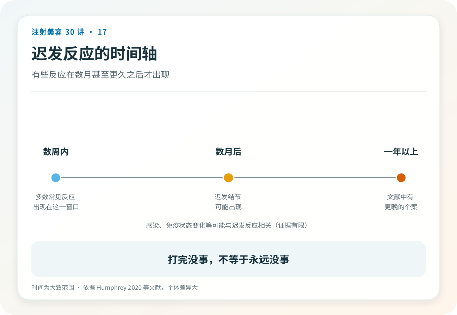

# 注射美容 17｜结节、肉芽肿与迟发反应可能几个月后才出现

> **视角｜消费者长期观察指南** 本文建立“注射史是长期病史”的意识，不提供任何自行处理方法。

“打完三个月都好好的，突然摸到硬块，跟上次打的针有关系吗？”

迟发反应最大的认知障碍是时间距离，几个月甚至更久之前的注射，和今天的肿块，在直觉上很难连起来。很多人因此在就医时漏报了关键病史，也有人反过来，在焦虑中把一切皮肤问题都归因于注射。这篇帮你把时间轴摆正。

## 三段时间轴

注射的不良反应按出现时间大致分三段。

即刻反应（当场到几天内），淤青、肿胀、酸胀，多为操作创伤本身，通常自行消退。

早期问题（几天到几周），感染、血管事件的后续表现。这一段的危险信号在第 14、26 篇。

迟发问题（数周、数月甚至更久），结节（可触及的硬块）、肉芽肿（慢性炎症性包块）、迟发性红肿。这一段最容易被漏掉，因为“当时没事”让人以为已经安全着陆。

## 迟发反应从哪来

机制候选有几类，证据成熟度不同，如实标注。

材料相关的异物反应个体差异，尤其再生类材料（第 16 篇）；生物膜假说，低度感染以静默状态存在，某个时点被激活（这是文献中活跃讨论的假说，不是定论）；免疫状态变化，文献中有感染、疫苗接种等免疫刺激后出现迟发性红肿的报道，提示免疫背景参与其中，但因果链尚不完整。

对消费者，机制细节不重要，重要的是结论，迟发反应真实存在，且与你的免疫状态可能相关。这就是为什么发热性疾病、重大手术前后，值得把注射史告诉医生。

## 大样本数据怎么说

一项对 4500 余例透明质酸填充患者的回顾研究显示。迟发不良事件真实存在，但总体少见。

这个数据的正确用法是同时压住两头，它否定“正规产品绝不会有迟发问题”的过度安抚，也否定“打过填充迟早出事”的恐慌叙事。少见但真实，所以需要的不是恐惧，是长期观察的意识。

## 摸到硬块，怎么分层

无痛、稳定、不增大的小结节，不属于急症，但应就医评估，带上注射档案。

红、肿、热、痛，或进行性增大、破溃渗出，尽快就医，这提示活动性炎症或感染。

共同的底线，都不要自行按摩、热敷、吃“消炎药”处理。这些动作可能加重炎症扩散，也会干扰医生后续的判断。

## 再强调一次注射档案

产品注册名、批号、注射时间、注射机构。每次注射都留下这四样。

迟发反应的诊疗高度依赖“打的是什么”，透明质酸相关的问题有溶解这个选项，再生材料相关的没有；不同材料的处理路径完全不同。就医时主动提供完整注射史，包括很久以前的。不要因为“过去太久了”而省略，迟发反应的时间跨度可以超出你的直觉。

## 证据边界

迟发反应的机制多处于假说与观察阶段，本文标注的“候选机制”不应被引用为确定结论。发生率数据来自特定产品与人群的研究，不能外推为所有填充材料的通用数字。

延伸阅读

- [Humphrey 2020 透明质酸填充 4500 例迟发不良事件回顾](https://pubmed.ncbi.nlm.nih.gov/32035107/)
- [Woodward 2015 面部填充并发症综述](https://pubmed.ncbi.nlm.nih.gov/26505541/)

**针剂会被代谢，注射史不会。它从注射那天起就是你病史的一部分，请像保管病历一样保管它。**
