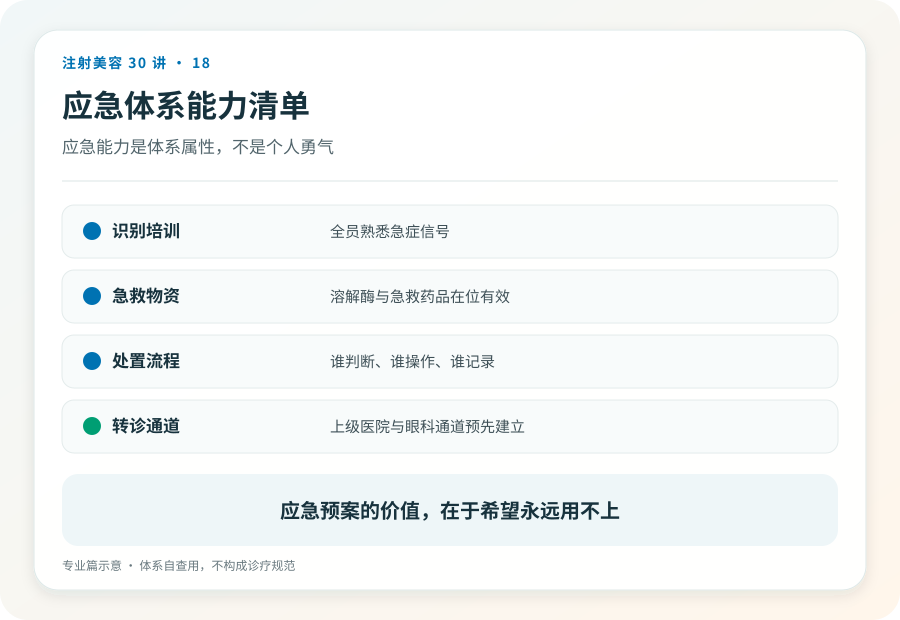
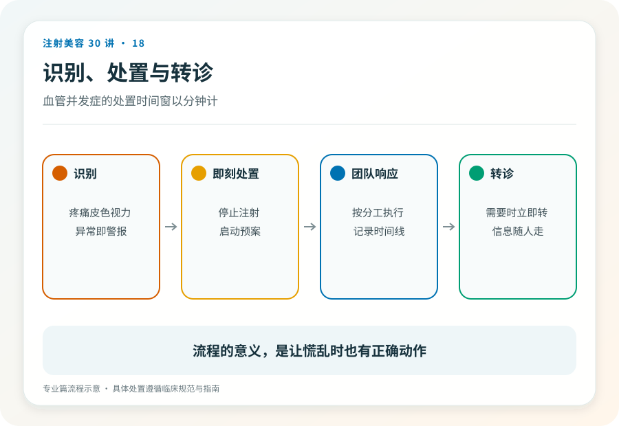

# 注射美容 18｜血管并发症的识别与应急体系是机构能力的试金石

> **视角｜从业者体系自查** 本篇面向专业读者，讨论应急体系的结构，不提供药物剂量与操作参数。

“我们备了溶解酶。”。这句话正在成为机构级的自我安慰。

血管并发症的应对是一个体系，识别速度、处置流程、转诊通道、演练频率。溶解酶只是这个体系里最容易采购的一环，也最容易成为掩盖体系缺失的遮羞布。药柜里的一支库存，救不了一个没有流程的机构。

## 结局由速度决定

复盘致盲与坏死病例的文献，一条主线反复出现，结局差异主要来自识别与响应的速度。

从注射者对即刻征象的警觉，到机构内标准化处置的启动，再到向眼科、急诊的转运。每一环的延迟，都在消耗不可再生的组织存活时间。这不是“技术好就不会出事”的领域，而是“出事时体系有多快”的领域。

需要如实标注的不确定性，眼动脉事件的各类抢救手段（包括球后注射等）有效性证据有限且存在争议，文献回顾中没有任何手段被证明稳定有效。这个事实不是放弃抢救的理由，而是把重心前移的理由；预防与速度，比任何单一“绝招”都可靠。

## 识别层｜警觉是第一道防线

注射中与注射后即刻的警示征象，与操作强度不匹配的剧烈疼痛、注射区域或远隔区域皮肤变白、花斑样或网状颜色改变、患者的视觉主诉（视力下降、视野缺损、眼前发黑）、剧烈头痛与恶心。

原则层面的操作警觉（不涉及具体手法参数），高危区操作时的持续观察习惯、与患者保持语言交流以便即时捕捉症状、每次推注之间留出观察间隔。识别的责任无法下放，操作者本人必须是第一个报警器。

## 时间窗不同，两套预案不能合并

皮肤缺血与眼动脉事件的时间窗完全不同，前者的组织存活以小时计，有相对从容的处置与转诊空间；后者以分钟计，几乎没有院内周转的余地。

这决定了预案必须是两套，皮肤缺血预案的核心是院内快速处置流程；眼部事件预案的核心是最短路径转运，事先建立的眼科转诊协议、联系人、转运方式，在事件发生时直接执行而不是现场查电话。

## 体系层｜机构的最低配置清单

书面应急流程，而不是口头共识，写下来的流程才能被检查、被演练、被改进。明确的职责分工，谁识别、谁处置、谁联系转诊、谁与患者及家属沟通。溶解酶的可及性管理，存量、效期、存放位置全员知晓。眼科与综合急诊的转诊协议，书面、有联系人、定期确认有效。演练记录，从发现症状到启动转运的全流程计时演练。

这份清单同时是机构自查表和行业底线主张，无完整应急体系的机构，不应开展高危区填充。这是本系列明确的价值判断。

## 上报层与患者接口

不良事件的记录与上报，既是合规要求，也是行业证据生态的一环（与第 11 篇的逻辑同构）。每一个被完整记录的病例，都在改进整个行业对这类事件的认识。

最后是消费者端的接口，知情同意中诚实呈现这套体系。能坦然回答“如果栓塞了你们怎么办”的机构，才配做高危区注射。这个问题会出现在本系列第 25 篇的消费者面诊清单里，从业者应当预期被问到，并且欢迎被问到。

## 证据边界

本篇不提供溶解酶剂量、给药途径与间隔，不描述球后注射等操作。这些属于需要培训与资质的临床技能，且其证据基础本身仍在演进。体系清单是编辑构造的自查框架，不是行业标准文件。

延伸阅读

- [Beleznay 2015 填充剂致盲世界文献回顾](https://pubmed.ncbi.nlm.nih.gov/26356847/)
- [Woodward 2015 面部填充并发症综述](https://pubmed.ncbi.nlm.nih.gov/26505541/)

**并发症不挑机构，但结局挑。你的应急体系在事故发生前，就已经决定了那个患者的结局。**
