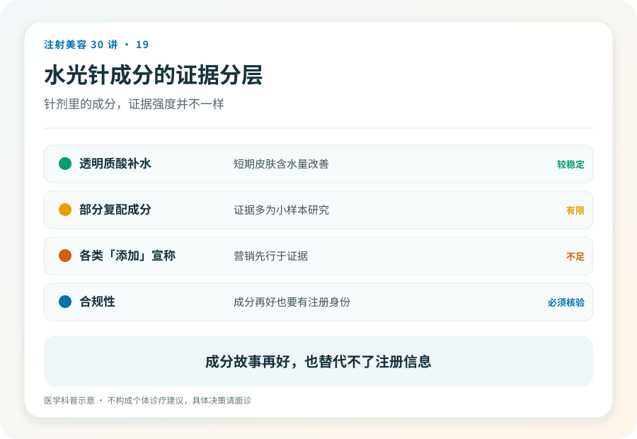
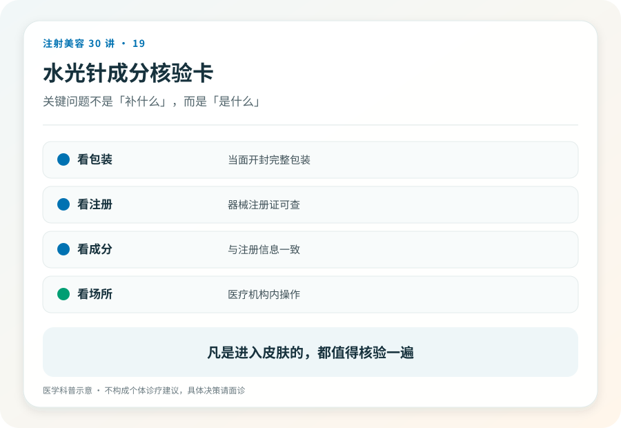

# 注射美容 19｜水光针打进去的到底是什么

> **视角｜消费者认知起点** 本文拆解“水光”这个名字掩盖的成分问题，不评价任何机构的具体配方。

在消费认知里，水光针被放在“医美轻食区”，入门款、基础款、成分就是保湿的，最安全。

但水光恰恰是成分最不透明、混配最随意的品类之一。原因藏在名字里，“水光针”不是一个产品的名字，而是一类操作的名字，也就是用微量多点的方式，把某些东西注入皮肤。这个“某些东西”，才是决定风险的全部。

## 操作名 ≠ 成分名

两家机构的“水光针”可以是完全不同的东西，基础液不同、添加物不同、来源不同。你以为在选“打不打水光”，实际要选的是“允许什么被打进皮肤”。

风险的重心也因此转移，水光的注射深度浅，操作层面的风险相对可控。真正失控的是配方。每一种被加进针管的成分，都是一个需要独立核验注册身份的对象。

## “基础液＋添加物”的行业现实

常见的模式是，合规的透明质酸产品做基础液，再按“套餐”叠加各种添加物；美白的、修复的、抗衰的，名字一个比一个诱人。

判断原则只有一条（呼应第 03 篇），身份跟随使用方式改变。凡是以化妆品、试剂或其他非注射身份存在的成分，被抽进注射器就已越界。无论它涂在脸上多安全、故事讲得多科学。“进口精华原液”“院线专供安瓶”这类描述，翻译过来往往就是，一个没有注射注册身份的东西。

面诊时的关键句因此变成，“今天注射的每一种成分，分别给我看注册证。”注意是每一种，基础液合规，不能豁免添加物。

## 合规水光的证据现状

即便全部成分合规，也需要诚实交代证据强度，透明质酸微注射类操作的临床研究，目前以小样本、短随访为主，长期获益的证据有限。

这不是说它无效，而是校准预期，“入门款”的说法既低估了配方失控的风险，也高估了现有证据能支撑的承诺。把它当成一个证据仍在积累的可选项，而不是一个理所当然的日常保养。

## 你的两个权利

拒绝加料的权利，套餐里“送的”添加物，你有权利也有必要逐项过问、逐项拒绝；赠品逻辑不适用于进入皮肤的东西。

事后追溯的权利，要求机构在病历或单据上写明本次注射的全部成分与产品信息。写不出来的成分，本身就是答案。

打过成分不明水光后出现持续红肿、丘疹、硬结的读者，应就医评估，尽可能提供当时的消费记录。哪怕只有价目表截图，也比没有强。

## 证据边界

本文不列出具体灰色添加成分的名录，以免变成反向采购指南。透明质酸微注射的疗效证据以写作时的文献为准，扩展结论请查证最新研究。

延伸阅读

- [国家药监局数据查询（逐成分核验注册身份）](https://www.nmpa.gov.cn/)
- [国家卫健委医疗美容服务管理相关文件](https://www.nhc.gov.cn/wjw/c100221/202201/d7e8fa33a26b425da98d69fb04191699.shtml)

**水光针最该问的不是“打不打得进去”，而是“打进去的每一样东西，敢不敢把注册证摆在桌上”。**
