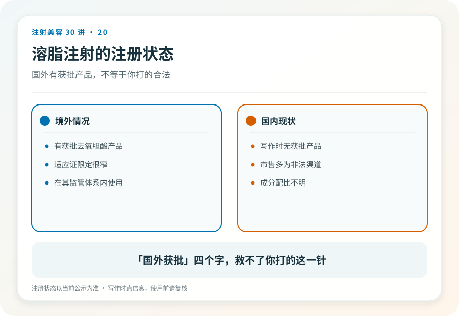
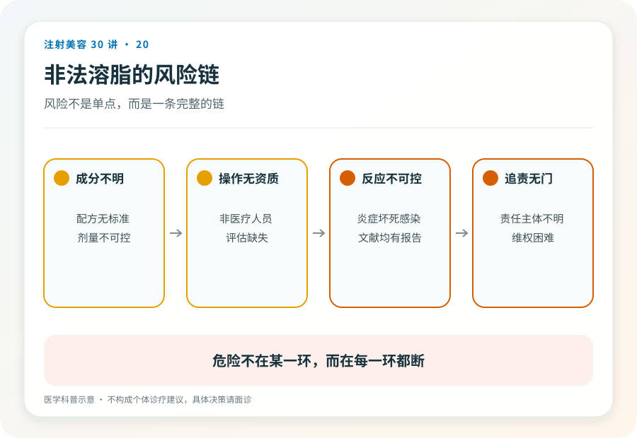

# 注射美容 20｜溶脂针为什么在国内不是合规选项

> **视角｜消费者监管警示** 本文写作时中国无获批注射溶脂产品，发布与阅读时请按药监局当前公示复核。

“国外都在用溶脂针，国内工作室也有渠道，是不是只是还没引进？”

这句话是水货溶脂针最有力的推销话术，它把监管时差偷换成了安全背书。需要把这句话拆成两半来看，前半句部分为真，后半句完全为假。

## 事实的两半

为真的一半是，国外确实存在获批的注射溶脂产品。美国 FDA 批准过去氧胆酸注射产品，用于改善成人颏下（下巴下方）中重度脂肪堆积。

为假的一半，截至本文写作时，中国没有批准任何注射溶脂产品（以药监局当前公示为准）。这意味着国内市场上流通的一切“溶脂针”，无论包装、故事、价格如何，都没有合法的注射身份；按第 03 篇的三轨模型，全部落在三无轨上。

“没引进”和“可以打”之间，隔着整个注册审查体系。针对本地人群的安全性数据、质控标准、追溯链条。跳过它们的产品，跳过的是这一切。

## 获批产品的边界有多窄

即使在获批国家，那款产品的许可范围也远比想象中窄。特定成分、特定部位（颏下）、由医生施用、有明确的禁忌与不良反应管理要求。

所谓“全身哪里胖打哪里”，包括大腿、腹部、手臂、脸颊，从来不是获批用法。换句话说，就算你在获批国家、由正规医生注射正品，超出颏下的“全身溶脂”也已经是超范围使用。而国内水货场景，是在没有任何一层保障的情况下做这件事。

## 水货的三重失控

真假不可验，脱离追溯体系的产品，无从确认是正品、稀释品还是彻底的假货；第 03 篇说过，对三无产品谈真假没有意义。

用法必然失控，没有注册就没有适应证边界，销售话术就是唯一的“说明书”。

出事无人负责，注射溶脂的并发症在文献与报道中包括皮肤坏死、感染、不规则凹陷；发生在非法场景时，没有病历、没有责任主体、没有赔付能力。

## 为什么这个品类特别危险

溶脂针踩中了一个危险的组合，减肥焦虑的巨大需求＋对手术的恐惧＋监管最薄弱的供给。需求越急切、替代路径越让人却步，非法供给的空间就越大。

这个结构值得单独警惕，当你发现自己“特别想相信”一个产品的时候，恰恰是核验最不能省略的时候。

想解决局部脂肪问题的合法路径是，到正规医疗机构面诊，评估是否适合吸脂等合规术式，或者根本不需要处理；“不做”永远是择期项目的合法答案。

## 已经注射过的读者

出现皮肤凹陷、硬结、红肿、坏死迹象，立即就医，说明注射时间、部位与来源。

暂无症状的，也建议就医记录在案（第 17 篇讲过迟发问题的时间跨度），并保留付款记录、聊天记录、包装照片等一切凭证。它们同时是医疗信息和维权证据（第 27 篇）。

## 证据边界

本文的监管状态描述有明确时效性，“中国无获批注射溶脂产品”以写作时点为准，任何时候引用本文，都应先到药监局官网复核当前状态。

延伸阅读

- [国家药监局数据查询（复核注册状态）](https://www.nmpa.gov.cn/)
- [FDA 已批准产品信息（对照，获批范围之窄）](https://www.fda.gov/medical-devices/aesthetic-cosmetic-devices/fda-approved-dermal-fillers)

**监管的时差里长不出安全的捷径，一支针在这里没有名字，它的风险就没有上限。**
