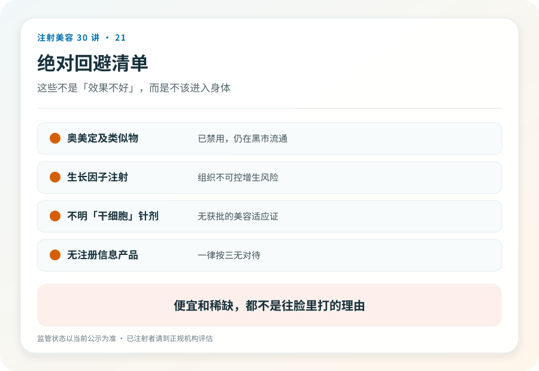
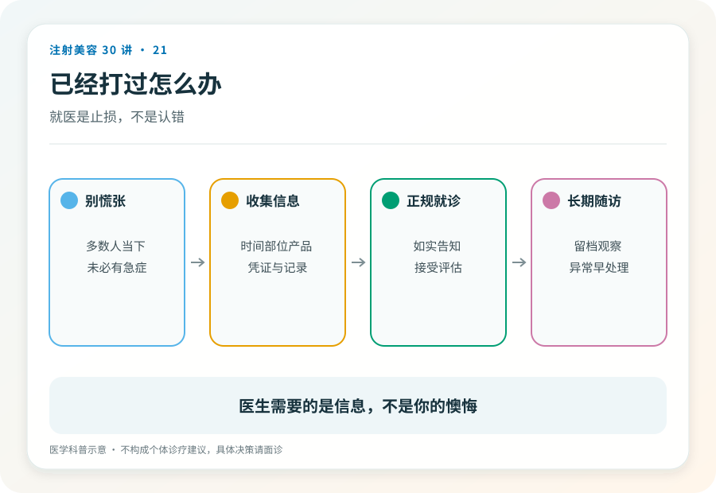

# 注射美容 21｜绝对不能打的清单，这些针没有讨论空间

> **视角｜消费者红线清单** 本系列极少给“绝对”结论，这篇是例外。这些项目的风险结构里没有可管理的部分。

前面的篇目教的都是核验方法，怎么查、怎么问、怎么权衡。但有一类注射不需要这些，不用分析、不用权衡，看到就走。

这张清单的共同点是，伤害不可控或不可逆。它们不需要你聪明地分析，只需要你转身离开。

## 清单与理由

**一切无注册证的针剂。** 这是总纲，覆盖后面所有具体项。查不到注册证的产品（第 03 篇），成分、纯度、来源全部不可知。你不是在冒“效果不好”的险，而是在冒“不知道打进去什么”的险。

**注射用“生长因子”。** 生长因子类产品在国内没有注射美容的合法身份。它的可怕之处在机制上，促生长的信号打进组织后，增生无法定向、无法叫停；文献与临床报道中，注射部位的失控增生可以在数年后仍在进展，修复极其困难，切除后甚至可能刺激再次增生。这是“不可逆”的最坏形态，不是留下一个结果，而是留下一个进程。

**奥美定及一切“永久填充”话术。** 聚丙烯酰胺水凝胶（奥美定）已被禁用多年，但以“人工脂肪”“永久玻尿酸”等新名字借尸还魂的现象从未绝迹。它会迁移、变形、引发慢性炎症，且难以彻底取出；“永久”在填充语境里不是卖点，是警报（第 04 篇的光谱最右端）。任何用“永久”“一次搞定终身”做卖点的填充产品，直接出局。

**“干细胞美容注射”。** 截至写作时，国内没有任何获批的干细胞美容注射适应证。市面上的“干细胞针”成分成谜。这个词在营销中的功能是借用前沿科研的光环。正规的干细胞研究在严格监管的临床试验框架内进行，不在美容院的价目表上。

**来源不明的“美白针”“排毒针”。** 混合静脉输注类项目，成分组合随意、系统性暴露、无注册支持；风险直接从“局部”升级到“全身”。

## 话术模式本身就是识别器

回看这张清单，它们的推销话术高度雷同。

疗效叙事宏大，永久、根治、逆龄、一次解决；来源叙事神秘，内部渠道、海外直邮、实验室直供、还没上市；价格结构诱人，比正规产品便宜得多，或者贵得“物有所值”。

记住这个模式比记住产品名有用，产品名每年翻新，话术结构十年不变。宏大疗效＋神秘来源＝转身离开，不需要第三个条件。

## 已经打了怎么办

无论有无症状，都应到三甲医院整形外科或有修复经验的正规机构评估建档。生长因子和奥美定类的问题尤其如此，早期评估能为后续处理保留更多选项。

出现红肿、变形、移位、疼痛加重，尽快就诊。不要回到原渠道“修复”，让制造问题的人处理问题，只会叠加新的伤害。保留一切凭证（第 27 篇会讲它们的用途）。

## 证据边界

本清单基于写作时的监管状态与文献报道，具体产品的禁用与批准状态请按药监局当前公示复核。清单会随监管变化更新，但它的判断逻辑不变，不可核验＋不可逆＝不可打。

延伸阅读

- [国家药监局数据查询](https://www.nmpa.gov.cn/)
- [国家卫健委医疗美容服务管理相关文件](https://www.nhc.gov.cn/wjw/c100221/202201/d7e8fa33a26b425da98d69fb04191699.shtml)

**聪明人最容易犯的错，是对不值得分析的东西做了分析。这张清单存在的意义，就是让你省下那次分析。**
