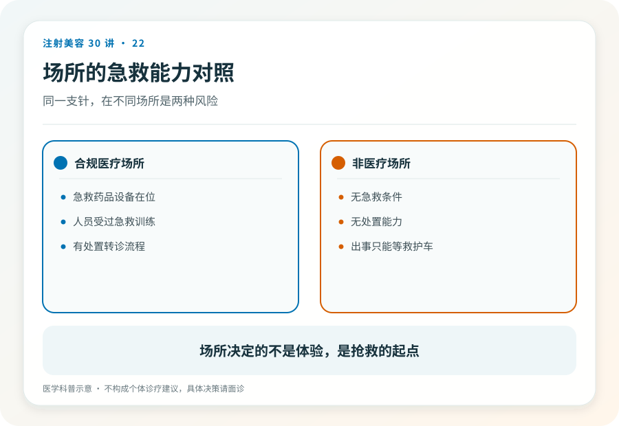
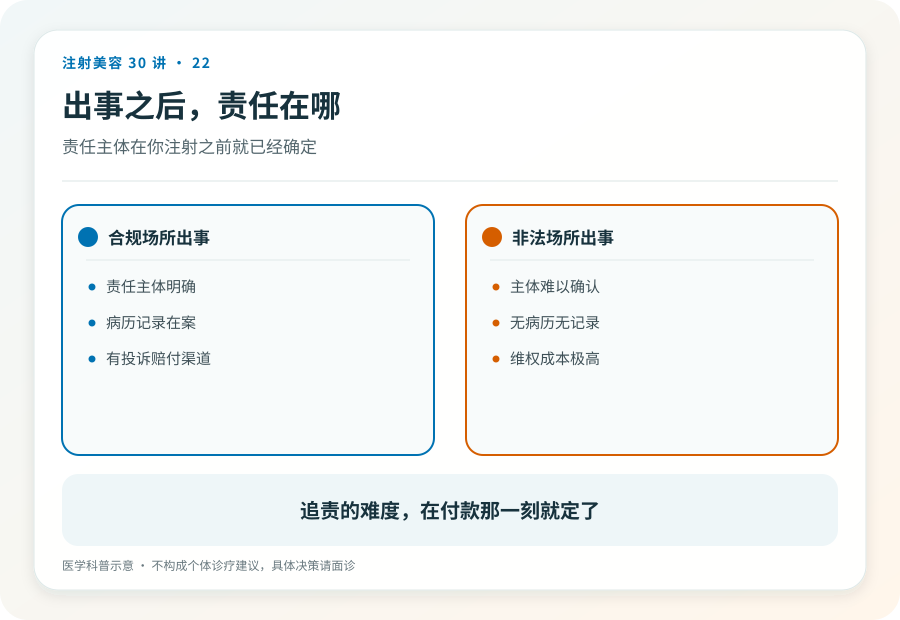

# 注射美容 22｜场所决定生死，酒店、工作室、上门服务的风险等级完全不同

> **视角｜消费者风险校准** 本文解释为什么“同一个医生换个地方打”不是省钱，而是换了一个风险等级。

“同一个医生，在医院打八千，私下约在工作室打三千，为什么不选便宜的？人是一样的啊。”

这个问题值得认真回答，因为它的逻辑漏洞不明显。它把医疗安全绑定在“人”身上，却完全没有意识到，场所不是打针的背景板，而是医疗安全的组成部分。

## 用栓塞场景做一次推演

回到第 14 篇的场景，注射中患者突然剧痛、视物模糊。现在把这个场景放进工作室，逐分钟推演。

没有急救药械，溶解酶、急救药品、设备，都在那家没被选择的医院里。没有流程，谁识别、谁处置、谁联系转诊？工作室里只有一个人，而她正在慌。没有转诊通道，不存在事先建立的眼科协议，只能现场搜电话。甚至可能没有那通 120，非法执业的场所，报警求救等于自我暴露，拖延和掩盖是更常见的第一反应。

第 14 篇说过，这类事件的时间以分钟计。上面每一段，都在消耗那几分钟。

## 医疗安全 = 人 × 系统

“人是一样的”这句话错在乘法算成了加法。医生的判断与技术，需要乘上系统才构成安全。这个系统包括急救体系、无菌条件、药械追溯、责任框架。离开机构的医生，身后这些全部归零。

还有一层更隐蔽，一个愿意私下执业的医生，其行为本身已经违规。这意味着两件事，一是他对规则的态度已经写在行动里，二是出事时他的第一利益是掩盖而不是抢救。“人是一样的”预设了人格在两个场景中恒定，但激励结构已经完全不同了。

## 药械也随场所改变

正规机构的药械有完整进货链，从厂家到机构，每一环可查、冷链有记录。

工作室里“同款产品”的来源只有话术支撑。就算真是正品，脱离冷链与追溯的生物制品（第 03 篇讲过）已经不是原来那个产品。你在工作室省下的差价里，包含了“正品”这个词本身的贬值。

至于上门注射。它把所有风险因素集齐了，没有场所、没有设备、没有追溯、没有责任主体，连一张可以指认的经营地址都没有。这是风险光谱的最末端。

## 差价买走了什么

现在可以算清那五千块的账，它买走了急救能力、无菌保障、药械追溯、责任主体；恰好是出事时你需要的全部，也恰好是不出事时你看不见的全部。

低价场所的商业模式，本质是把“看不见的成本”砍掉，把省下的一部分让给你。赌的是不出事；赌注是你的脸和眼睛。

判断一个场所能不能打针，看的不是装修、不是熟人、不是“打过很多例”，是三样，许可证（第 05 篇）、急救准备、出事时找得到的责任主体。

## 已经在非医疗场所注射过的读者

暂无不适的，把注射信息记录在案（时间、内容、场所、付款记录）。出现任何不适的，就医并如实说明场所与来源。医生需要这个信息判断风险，这不会也不应成为你被指责的理由。健康永远优先于面子。

## 证据边界

本文的风险推演基于急救时间窗的一般逻辑与监管框架，不针对任何具体场所。合法场所类型与资质要求以卫生健康部门当前规定为准。

延伸阅读

- [国家卫健委医疗美容服务管理相关文件](https://www.nhc.gov.cn/wjw/c100221/202201/d7e8fa33a26b425da98d69fb04191699.shtml)
- [Beleznay 2015 填充剂致盲世界文献回顾（急症时间窗的依据）](https://pubmed.ncbi.nlm.nih.gov/26356847/)

**打折的从来不是针剂，是你出事那一刻身边的一切；那一刻你才知道，差价买的是什么。**
