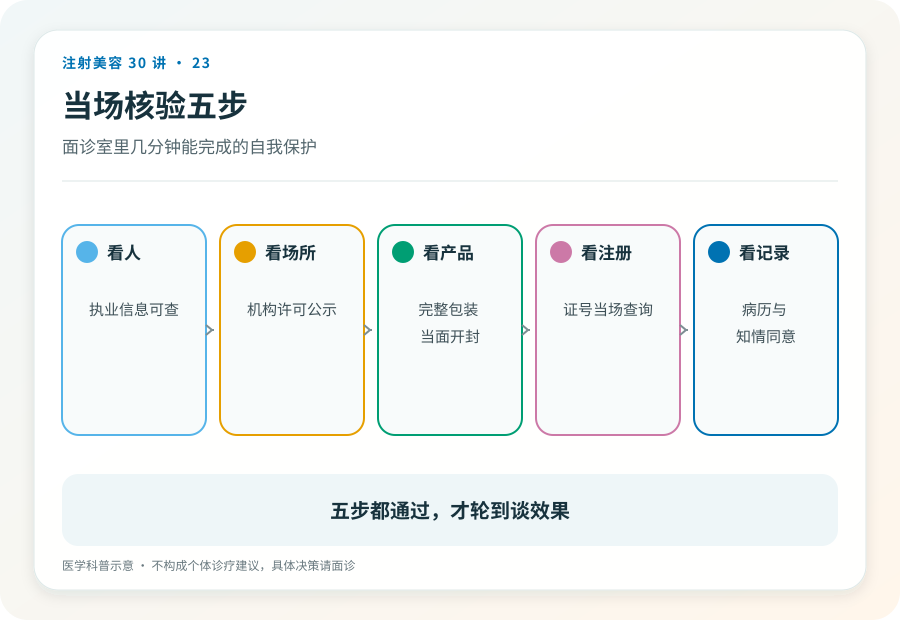
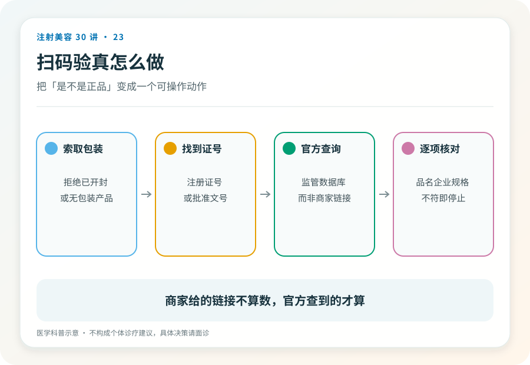

# 注射美容 23｜核验一支针剂只需五个动作、两分钟

> **视角｜消费者操作清单** 本文是全系列核验意识的落地版。当场可执行、不需要专业知识、不怕得罪人。

“道理都懂，但真躺在床上了，我到底该做哪几个动作？”

这篇只回答这个问题。五个动作，全程两分钟，任何一步被拒绝或含糊带过，就是离开的信号。

## 先解决心理障碍

核验最大的敌人不是造假技术，是你的不好意思，怕尴尬、怕“显得不信任医生”、怕破坏气氛。

换个角度想，正规机构对这五个动作习以为常。产品信息本来就该展示，当面拆封本来就是规范，你不是第一个查的人，也不会是最后一个。只有心虚的场所才会觉得被冒犯。对方的反应本身就是核验结果的一部分。

## 五个动作

**一看注册证。** 开口要求，“请出示这支产品的注册信息。”正规机构能直接拿出来。看注册产品名。它应该和你面诊时谈的产品对得上（第 02 篇的翻译链在这里兑现）。

**二对包装。** 包装上的产品名称、生产厂家，与注册证信息一致；包装完整、标签清晰、在效期内。汉字都不认识几个的“纯进口包装”且拿不出中文注册信息的，直接红牌（第 03 篇说过，在中国合法注射的前提是在中国注册）。

**三查批号。** 用手机在药监局官网数据查询入口，按产品名或注册证编号当场检索比对。两分钟里最硬的一步。它不依赖对方给你看什么，只依赖公开数据库。

**四验拆封。** 要求当面拆封全新包装。预开封的、分装的、“上一位客人没用完的”，一律拒绝。这是最常见的掉包与稀释场景。这个要求没有讨价还价空间。

**五留记录。** 拍照，产品信息页、批号、注册证。这就是第 09、17 篇反复强调的注射档案的第一页。未来任何就医、评估、维权，都从这几张照片开始。

## 两个边界要讲清楚

核验通过 ≠ 绝对安全。五步验证的是产品合法性；操作风险（第 14 篇）、方案合理性（第 13 篇）是另外两条防线。产品是真的，不代表方案是对的，方案的核验在面诊（第 25 篇）。

不训练肉眼鉴宝。本文刻意不教“如何分辨高仿包装”，真假鉴别交给注册查询和当面拆封这两个制度动作，而不是你的眼力。把鉴别游戏化，反而会给你虚假的信心。

## 被拒绝时的标准动作

任何一步遭遇拒绝、拖延、转移话题（“我们是大机构不用查这些”“系统里有你放心”），标准动作只有一个。起身离开。

不需要争论，不需要给理由，不需要给对方“解释的机会”；解释的机会在你提问时已经给过了。择期项目的全部谈判筹码就在于，你永远可以不做。

## 证据边界

药监局查询入口的具体页面与操作路径以官网当前版本为准，本文不固化具体界面描述。五步清单是消费者自保动作，不替代监管与机构的质控责任。

延伸阅读

- [国家药监局数据查询](https://www.nmpa.gov.cn/)
- [国家卫健委医疗美容服务管理相关文件](https://www.nhc.gov.cn/wjw/c100221/202201/d7e8fa33a26b425da98d69fb04191699.shtml)

**你不需要成为专家，只需要在两分钟里做完五个动作；专业的门槛已经由监管体系替你建好了，你只要走到门口验一下票。**
