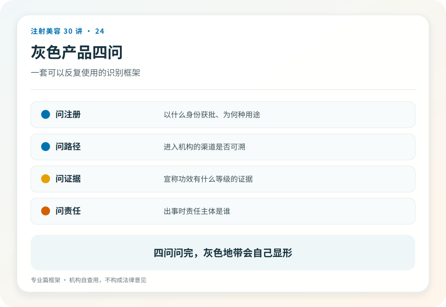
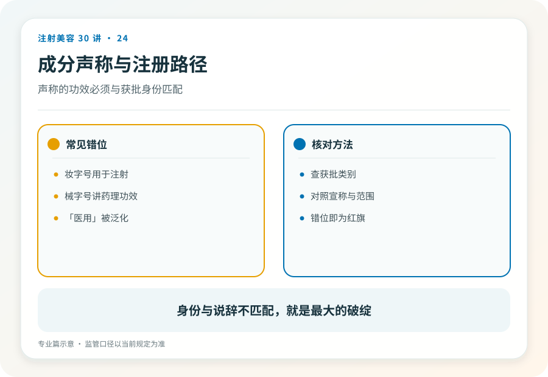

# 注射美容 24｜给从业者的灰色注射产品边界自查框架

> **视角｜从业者合规自查** 本篇面向专业读者。灰色地带的风险最终由操作者的执业资格和患者的组织承担。

从业者的合规意识常有一种“近视”，主打产品有证，就认为整台操作合规；对搭配使用的添加成分、“院内配制”、超适应证使用和新品类的注册路径，习惯性含糊。

这种近视的代价结构是不对称的，灰区的收益归当下，风险挂在你的执照上、落在患者的组织里。

## 四问框架

判断一个注射产品或用法是否踩线，依次问四个问题。

**一问身份，这个成分以什么身份注册？** 药品、器械、化妆品，还是查无此物？这是消费者篇第 03 篇的同一问题，但从业者的责任版本。你有义务在使用前查清，而不是相信供应商的宣传页。

**二问途径，注册的预期用途是否包含注射给药？** 化妆品级成分被注射，是当前最高频的踩线形态。“成分本身安全”不构成辩护，身份跟随使用方式改变，注册审查针对的是特定给药途径下的风险。

**三问范围，本次使用是否在适应证与部位范围内？** 器械与药品的注册范围有明确边界，跨部位、跨适应证的外推需要独立的正当性论证。

**四问辩护，超范围使用有没有可辩护的支撑？** 超说明书用药在医疗实践中存在合法空间，但有严格前提，有可依据的证据基础、无更优替代、履行了充分的知情同意、有机构层面的审批与记录。四个前提是“与”的关系，只引用“超说明书用药是合法的”这半句，而不满足前提，是断章取义式的自我豁免。

四问中任何一问答不出来，操作者面对的就不是学术争议，而是执业风险。

## 用框架扫描当前高频灰区

水光添加物，基础液合规、添加物成谜的组合（消费者篇第 19 篇的从业者镜像）。每一种添加成分独立过四问，通不过的成分，一支合规基础液救不了整个配方。

“妆字号”械用，以化妆品身份注册的产品被用于注射或微针导入。第二问直接不通过。

“学术交流”渠道的未注册进口产品，以试用、交流名义流通的无证产品，第一问不通过；学术标签不产生注册效力。

“院内配制”混合针剂，多种成分现场混配。即使每种成分单独有证，混合物本身的稳定性、相互作用、无菌保障都脱离了注册审查的覆盖。这是第三、四问的复合失败。

## 机构制度是个体医生的防线

个体医生的自保依赖机构制度，采购链审核（供应商资质、产品注册、进货记录）、超适应证使用的院内审批流程、书面知情同意模板、不良事件记录。

反过来也成立，机构的违规最终落在医生执照上。在一家采购链混乱的机构执业，你实际上在为自己没有参与的决策承担职业风险。这本身应该成为择业判断的一部分。

## 以注册状态为锚的信息习惯

新品类层出不穷，可靠的观察方法不是跟着厂商学术会的节奏走，而是建立三个信息锚点。注册数据库动态（新批准、变更、撤销）、监管通报（违规查处、警示信息）、学会立场文件（与商业利益保持距离的专业判断）。

厂商提供的信息有其价值，但它在证据分层里的位置，应该始终低于以上三者。

## 灰区经济学

最后算一笔账，灰区利润高，恰恰因为合规者少。这个溢价本质上是违规风险的对价。而定价时几乎没有人把被吊照、赔偿、刑责的期望成本算进去。

灰色地带里没有中间人，要么你替监管把住了边界，要么你替患者试出了代价。

## 证据边界

本篇的法规框架描述以写作时的监管体系为准，具体条文与新品类的注册路径归类可能调整；框架比结论耐用，四问的结构不随个案变化。

延伸阅读

- [国家药监局数据查询](https://www.nmpa.gov.cn/)
- [国家卫健委医疗美容服务管理相关文件](https://www.nhc.gov.cn/wjw/c100221/202201/d7e8fa33a26b425da98d69fb04191699.shtml)

**灰色地带里没有中间人，要么你替监管把住了边界，要么你替患者试出了代价。**
