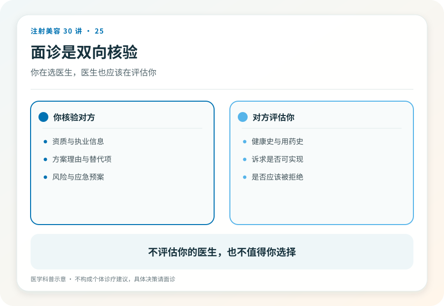
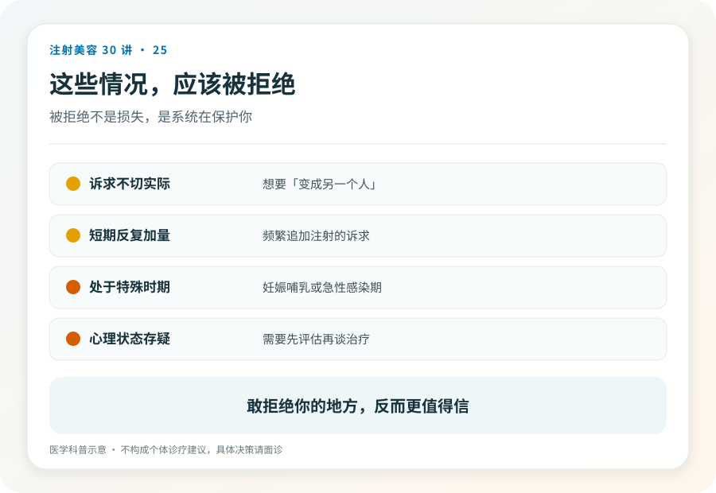

# 注射美容 25｜面诊是双向核验，你也在面试对方

> **视角｜消费者决策工具** 本文给你一张问题清单，用法是观察对方“怎么回答”，而不是背题对答案。

多数人把面诊理解成一个单向流程，被评估、听方案、看报价、决定买不买。

但面诊同时是你核验机构与医生的唯一窗口。它是整个注射决策里信息密度最高的环节。你不需要听懂医学，只需要带着问题清单，观察对方怎么回答。回答方式比回答内容更能暴露一家机构的成色。

## 用问题清单为前文的核验收口

这张清单覆盖本系列前面所有核验点。

产品信息可以这样问，“今天用的产品，注册名和注册证编号是什么？”（第 02、23 篇）

人员身份可以这样问，“操作的是您本人吗？能看一下您的执业信息吗？”（第 05 篇）

风险底线可以这样问，“这个项目最坏的情况是什么？”对于填充类项目，要看对方是否主动、具体地谈到血管并发症（第 14 篇），而不是等你追问才轻描淡写。

应急准备可以这样问，“如果发生栓塞，你们的处理流程是什么？”（第 18 篇给出了机构端应有的答案样貌）

退出机制可以这样问，“如果我不满意或者后悔，这个材料怎么退出？”（第 04、15 篇）

替代方案可以这样问，“如果我不打，或者少打，会怎么样？”

## 评估姿态，而不是内容

听不懂专业术语没关系。你评估的不是内容的对错，是回答的姿态。

好的信号，具体（说得出流程和细节，而不是“放心我们很专业”）、诚实（承认风险和不确定性，主动谈“不打”的选项）、耐心（欢迎提问，不因被核验而不悦）。

红牌信号，回避（“这些问题不用担心”）、话术轰炸（用一串你听不懂的词淹没问题）、以“专业的事交给我们”终结提问、被问到应急预案时明显没有准备。

一个规律值得记住，一家机构怎么回答你的问题，就会怎么处理你的并发症。面诊时的每一次敷衍，都是预演。

## 知情同意书不是签字仪式

知情同意书是面诊的书面版本，正确用法是，逐条读，不懂就问，空白处先填后签，要求带走副本。

正常的机构不会催你当场签字，知情同意的本质是给你时间和信息做决定。“大家都是直接签的”“不用看那么细”这类催促，把法律文件降格成了流程道具，本身就是红牌。

## 强制冷静期是本系列的价值判断

明确标注这是本系列倡导的立场，面诊和注射分开两次进行，中间给自己至少几天的冷静期。

当天面诊当天注射，放弃的是你唯一的比较与反悔窗口。你没有机会问第二个医生、没有机会核对信息、没有机会在离开话术现场后冷静想一遍。而“今天订才有这个价”“档期正好空出来”之类的压单话术，恰恰是在攻击这个窗口。择期项目最大的谈判筹码就是可以等，别在椅子上交出去。

## 好机构会拒绝你

最后一个观察维度，面诊中被拒绝，往往是好信号。

“你的情况不建议做这个”“这个诉求用注射解决不了”“建议先解决皮肤炎症再来评估”，愿意少做一单的机构，把医学判断放在了销售前面。反过来，你说什么都“可以做”的机构，评估环节形同虚设（第 28 篇会从从业者视角展开这一点）。

## 证据边界

本清单是消费者自保工具，不构成对面诊质量的完整评价标准；具体医疗判断的对错，清单无法替你验证。它筛选的是态度与体系，这已经足够过滤掉大部分风险。

延伸阅读

- [国家卫健委医疗美容服务管理相关文件（知情同意与告知义务）](https://www.nhc.gov.cn/wjw/c100221/202201/d7e8fa33a26b425da98d69fb04191699.shtml)

**一家机构怎么回答你的问题，就会怎么处理你的并发症；面诊时的每一次敷衍，都是预演。**
