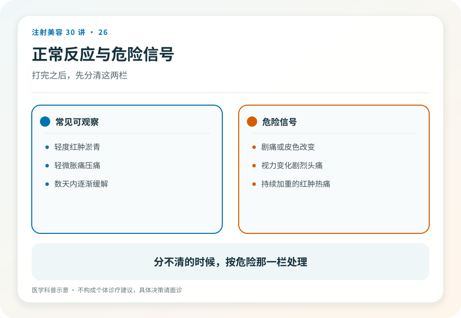
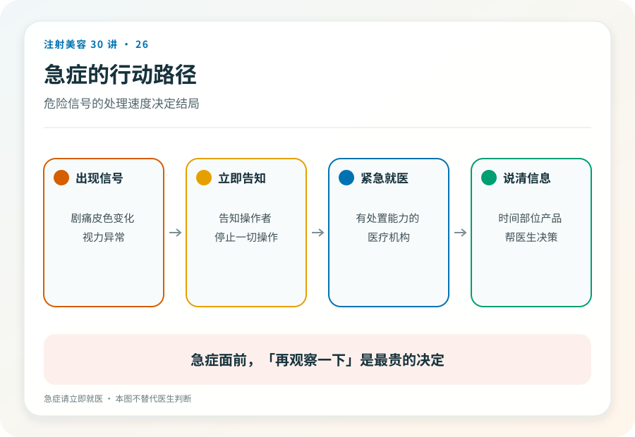

# 注射美容 26｜打完之后什么是正常反应，什么是危险信号

> **视角｜消费者术后指南** 具体医嘱以实施注射的医疗团队为准。本文帮你建立分层框架和求助路径，不提供居家处理方案。

“打完肿了，正常吗？”“摸着有颗粒感，要不要紧？”

注射后的头几天是搜索引擎的流量高峰，也是最容易被“多喝水多按摩”式回复耽误的窗口。这篇给你一个可以自己操作的分层框架。

## 三层框架

**预期内反应**，轻度肿胀、淤青、注射点酸胀、短暂的按压不适。它们是穿刺和材料植入的正常代价，一般在数天内逐渐减轻。

**需要回访的情况**，症状持续加重而不是减轻、明显不对称、可触及的硬结、持续的麻木感。不属于急症，但应联系注射机构复诊评估，而不是自己观察到底。

**必须立即就医的急症信号**，剧烈疼痛、皮肤发白或花斑样改变、视力下降或视野缺损、剧烈头痛呕吐、意识改变；以及发热伴注射区域红肿扩散。这一层不联系机构等回复，直接就医，时间以分钟和小时计。

这份急症清单与第 14 篇一致，是刻意重复，你可能只读到这一篇。

## 趋势重于快照

分层的钥匙不是症状本身，而是趋势，在好转，还是在加重？

同样是肿，第三天比第一天轻，是预期轨迹；反过来越来越肿、越来越痛，就是信号。所以比“我这样正常吗”更有用的问题是“今天和昨天比怎么样”。每天同一时间、同一光线拍一张照片，比任何记忆都可靠。这也是就医时最有价值的资料。

## 问对人，求助对象排序

第一顺位，实施注射的机构与医生。他们有你的操作记录，知道打了什么、打在哪、打了多少。这是术后咨询首选，也是正规机构应尽的售后责任。

第二顺位，正规医疗机构的急诊或相应门诊；机构联系不上、回复含糊、或症状已达急症层时，直接升级，不要在等待中消耗时间窗。

不该问的，销售顾问（她的职责是安抚而不是判断）、群友和评论区（他们看不到你，也不为结果负责）。

## 居家行为的边界

非医嘱不按摩、不热敷、不冷敷加码、不自行吃“消炎药”。

原因不是这些动作一定有害，而是有两点顾虑。一是它们可能掩盖或加速正在发生的问题（比如按摩可能促进材料移位、加重炎症扩散）；二是它们会干扰归因。医生需要知道症状的自然轨迹，而不是被多种自行处理搅浑的轨迹。

管住手，把处理权交给有你操作记录的人。

## 观察期结束 ≠ 观察结束

头几天平稳度过后，还有两件事。

远期观察，第 17 篇讲过，结节、肉芽肿等迟发反应可以在数月后出现；注射档案永久有效，任何时候出现注射区域的异常，就医时都要提供注射史。

档案归档，把这次的产品信息照片（第 23 篇）、术后照片、病历单据收进同一个文件夹。它是你的病史，也是可能用到的证据（第 27 篇）。

## 证据边界

不同材料、部位、操作方式的恢复轨迹差异较大，本文不给“X 天必消”式的时间承诺；症状分层依据的是紧迫性而不是诊断，判断是什么问题，永远属于医生。

延伸阅读

- [Woodward 2015 面部填充并发症综述](https://pubmed.ncbi.nlm.nih.gov/26505541/)
- [Humphrey 2020 迟发不良事件回顾](https://pubmed.ncbi.nlm.nih.gov/32035107/)

**打完那一针，机构的流程结束了，你的观察才开始。你是自己术后的第一责任人，也是最早能发现问题的人。**
