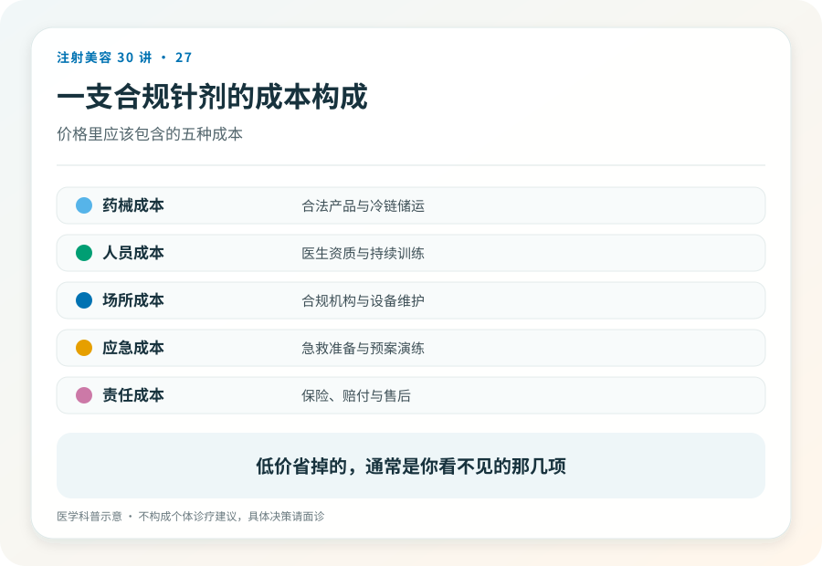
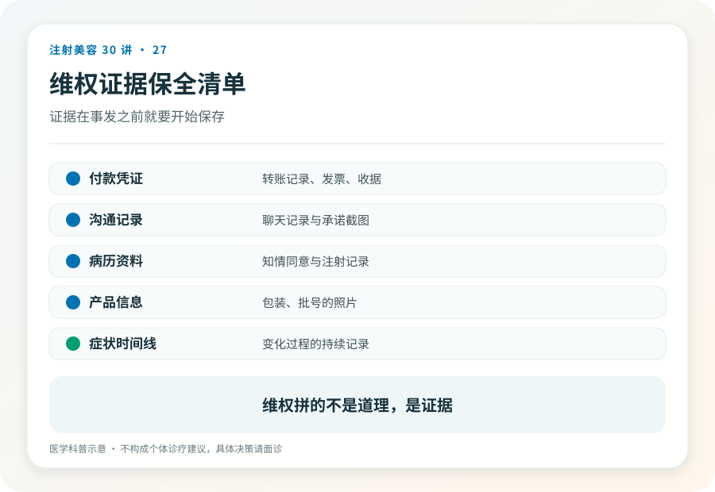

# 注射美容 27｜价格、修复与维权，钱的逻辑和出事后的路

> **视角｜消费者决策工具** 本文拆解价格结构与维权路径的通则，不评判具体价格，法律个案请咨询专业律师。

“同样的产品，为什么差价三倍？”“打坏了找谁？钱能要回来吗？”

价格困惑在决策前，维权无助在出事后。它们其实是同一个问题，你付的钱到底买了什么。

## 一针的成本结构

把正规注射的价格拆开，大致四块，药械成本（针剂本身）、技术与判断（医生的评估和操作）、合规成本（资质维护、保险、急救体系、规范流程）、品牌溢价。

关键洞察是，针剂本身往往不是大头。而低价版本砍掉的，几乎必然是中间两块，因为药械你看得见包装，品牌你听得见名字，只有“判断”和“合规”是看不见的，砍掉最无感。

第 22 篇从安全角度算过这笔账，这里是它的价格版本，差价买走的，恰好是出事时你需要的全部。

## 低价拼团的算术

“成本价引流”“亏本冲量”的套餐，不是道德问题，是算术问题，当引流价低于合规成本，利润必然从别处回来，包括升单（躺上床后追加项目）、换货（正品谈单、水货上针）、偷工（剂量缩水、分装稀释）。

不是每个低价套餐都作弊，但每个低价套餐都必须回答“利润从哪来”。你在下单前想不出答案的，机构已经替你想好了。

## 修复经济学告诉你“打坏了再修”不是备选方案

修复几乎总是比初次注射更贵、更难、更不确定，评估更复杂（要先搞清打了什么、在哪一层）、可能需要多次处理、部分损伤不可逆（第 04、15 篇的边界在这里变成账单）。

把“大不了再修”放进决策里的人，低估的不是修复的价格，是修复的不可保证性。前端多花的核验成本，永远是全链条里最便宜的一段。

## 维权路径在注射前就已经分叉

出事后的维权难度，不取决于你事后多努力，而取决于你当初在哪打的。

正规机构路径，病历、知情同意书、缴费凭证俱全，纠纷有明确的解决通道；与机构协商、医疗纠纷人民调解、医疗损害鉴定、诉讼。责任主体明确、有赔付能力，程序虽慢但走得通。

非法场所路径，对方涉嫌非法行医，可向卫生健康部门举报、向公安报案，民事索赔同步进行，但取证难（没有病历）、找人难（工作室注销跑路）、执行难（无赔付能力）。很多损失最终无法挽回。

这就是本系列反复强调核验的最后一个理由，核验不仅在保护你的脸，也在保护你未来可能需要的那条维权通道。

## 证据保全清单

从怀疑出问题的第一天开始留存，病历与知情同意书（复印件或照片）、缴费记录与合同、产品信息照片（第 23 篇的档案在此兑现）、症状照片（带时间线）、与机构的沟通记录、后续就诊的全部病历。

两个顺序不能反，先就医固定损害证据，再谈协商；健康优先于赔偿；对“退款换封口”的私了条款，签字前想清楚它可能关闭后续追责的门，拿不准就先咨询律师。

举报渠道，12315 平台（消费纠纷）、属地卫生健康部门（非法行医）、药监部门（假药械线索）。

## 证据边界

维权程序的细节因地区与个案差异较大，本文仅提供通则框架；具体法律行动请咨询专业律师，本文不构成法律意见。

延伸阅读

- [国家卫健委医疗美容服务管理相关文件](https://www.nhc.gov.cn/wjw/c100221/202201/d7e8fa33a26b425da98d69fb04191699.shtml)
- [国家药监局数据查询](https://www.nmpa.gov.cn/)

**最贵的针不是价目表上最高的那支，而是出了事没人负责的那支；维权最好的时机，是在付钱之前。**
