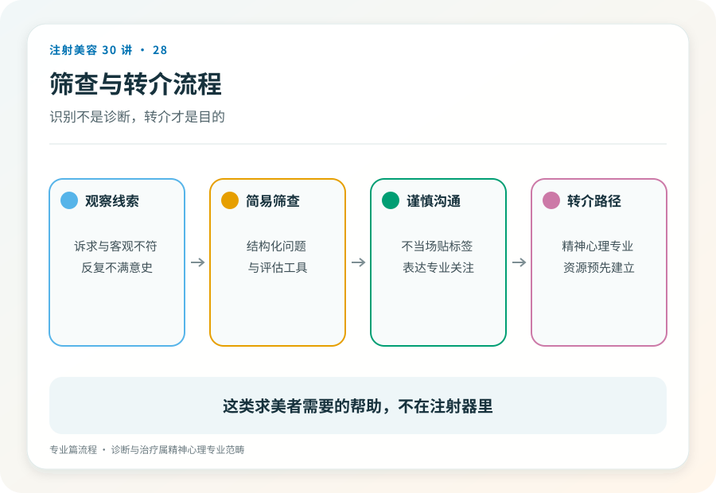
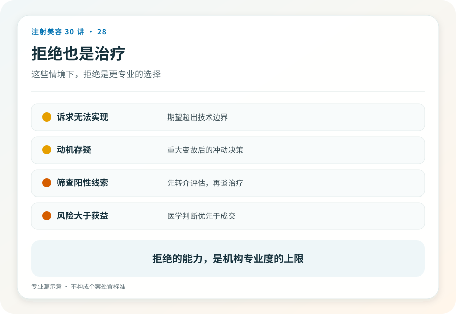

# 注射美容 28｜患者选择与心理评估，知道什么时候不打

> **视角｜从业者临床判断** 本篇面向专业读者。BDD 相关内容为临床识别框架，不构成诊断标准，不应被消费者用于自我诊断。

把“患者选择”做成禁忌证清单核对，是把这个环节做成了安检仪。扫一遍躯体项目，没报警就放行。

但注射美容真正的高风险人群画像里，有一大块是心理性的。这些患者在安检仪上不报警，技术上“能打”，临床上不该打。

## 三层漏斗

患者选择应该是三层递进的漏斗。

**躯体层**，禁忌证、用药史、过敏史、既往注射物。消费者篇已覆盖大半，专业视角补三点，既往注射物不明时的决策应当保守化（未知材料改变解剖与相互作用风险）；妊娠哺乳期的择期项目默认延期，不是因为有明确致害证据，而是因为没有理由让择期美容承担任何不确定性；神经肌肉疾病与肉毒的边界属于绝对严肃区。

**期望层**，诉求是否具体、可实现、与解剖条件匹配。“变好看一点”不可操作，“要某明星同款鼻子”不可实现。可用的澄清方法，让患者用自己的话描述困扰、给多个困扰排序、说出“能接受的最小改善”。期望无法落地成可实现的目标时，方案再精确也是错配。这单的正确结果是不成交。

**心理层**，最难，也最重要。

## 体象障碍是技术完美也救不了的错配

体象障碍（BDD）患者对外貌中微小或他人不可见的“缺陷”产生高强度的痛苦性关注。文献一致提示，BDD 在美容外科与皮肤科就诊人群中的比例显著高于普通人群（具体数字区间宽，受工具与人群影响）；BDD 患者接受美容操作后满意度低，症状可能不改善甚至恶化。

对这类患者，任何技术上完美的注射都是错误治疗；问题不在脸上，注射解决不了它，只会把关注点转移到下一个“缺陷”。唯一正确的方向是转介精神心理科。

面诊中的识别线索（是线索不是诊断），对他人不可见的细节的高强度痛苦、每日大量时间照镜子或修图、既往多机构多项目且从不满意的历史、社交回避、把生活困境归因于该“缺陷”。注射类项目门槛低、复购快，对 BDD 人群的暴露面比手术大得多。这正是注射从业者需要比外科医生更警觉的原因。

简易筛查工具存在（BDDQ 类问卷），其在中文语境与医美场景的效度数据有限；作为线索收集工具可用，作为决策依据不够。

## 拒绝的技术

“我建议现在不做”是一句需要练习的话。可用的结构，不否定感受（“你的困扰我听到了”）、给出专业判断（“但这个方案解决不了你描述的问题”）、给出方向（转介或再评估的路径）、留下门（“如果情况变化欢迎再来评估”）。

两条纪律，一是转介精神心理科的表述不带污名，它和转介眼科一样，是把患者送到正确的科室；二是拒绝要书面记录，包括评估内容、拒绝理由、给出的建议。这既是对患者负责，也是你自己的法律保护。

识别出 BDD 线索后继续注射获利，是本系列定义下的执业失格。这是价值判断，明确标注。

## 拒绝率是机构质量指标

一个值得管理层记录的数字，面诊后的“不成交率”中，有多少来自医生主动拒绝。

一家从不拒绝患者的美容机构，患者选择环节形同虚设。所有走进门的人都“适合”，等于没有人被评估过。把主动拒绝纳入机构的质量叙事而不是损失叙事，是这个环节真正建立起来的标志。

## 证据边界

BDD 患病率与结局数据来自国外为主的研究，中文人群与医美场景的数据有限；本篇的识别线索与拒绝框架是临床实践工具，不构成诊断标准，也不应被改写为消费者自测内容。

延伸阅读

- 扩写与发布时补充，BDD 在美容就诊人群中患病率的系统综述、美容操作与 BDD 结局研究（按 PubMed 当次检索核验）
- [国家卫健委医疗美容服务管理相关文件（评估与告知义务）](https://www.nhc.gov.cn/wjw/c100221/202201/d7e8fa33a26b425da98d69fb04191699.shtml)

**针筒最高级的用法是放下。你拒绝掉的那些注射，和你完成的那些一样，都是你的临床成绩单。**
