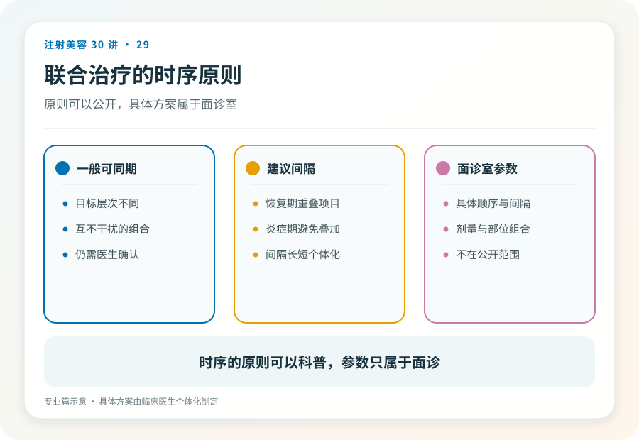
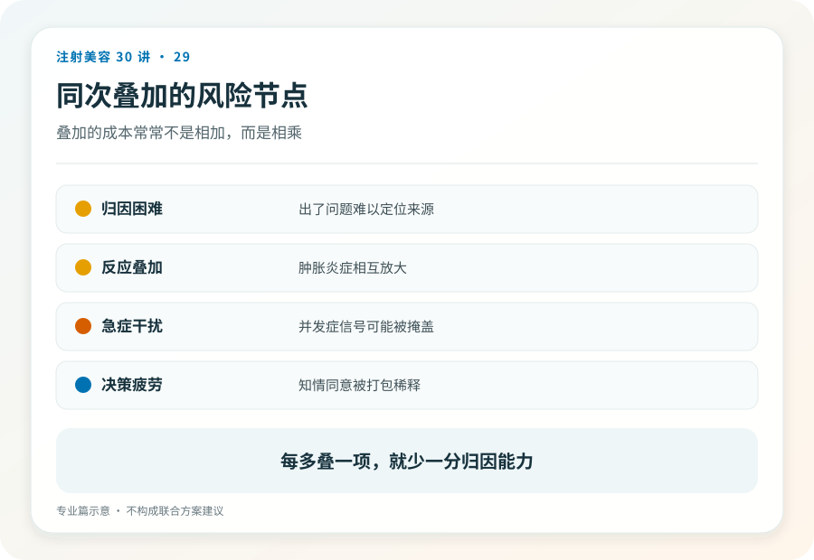

# 注射美容 29｜联合治疗中肉毒、填充与光电的时序设计

> **视角｜从业者方案设计** 本篇讨论时序原则，不提供“X 天后可做 Y”式的天数表；证据不足以支撑通用数字。

“一次做齐”的排期正在成为行业默认，肉毒、填充、水光、光电压进同一次到访。动机不难理解，留客、客单价、患者“少跑一趟”的偏好。

代价清单同样清楚，不良反应归因失效、材料与能量的相互影响不可控、并发症处置复杂化。这篇给出一条核心原则和一个设计框架。

## 归因逻辑是时序问题的临床本质

三个项目同天做，术后第五天出现红肿硬结，归谁？

肉毒的注射点？填充的迟发反应？光电的热损伤？水光添加物的刺激？归因失效不是学术洁癖，它直接瘫痪处置决策，不同来源的处置路径完全不同（第 17、18 篇），而你已经失去了区分它们的能力。

这就是核心原则，**每次只引入一个新变量，为每个环节保留独立的观察窗与归因能力。**观察窗的长度不是拍脑袋。它由该项目自身的不良反应时间轴决定，即刻反应看几天，迟发风险高的材料看更久。

## 相互影响需要分层讨论证据

联合使用时的相互影响，证据成熟度参差，如实分层。

有共识讨论的包括能量设备的热效应对已注射材料的潜在影响，机制上合理，具体阈值与时窗数据有限；还包括注射后组织水肿对光电参数判断的干扰，这是操作层面的常识性顾虑。

以推断为主的是肉毒扩散窗口期内的按摩类、加压类操作可能影响药物分布，机制推断成立，量化数据缺乏。

诚实的结论是，这是一个经验主导、数据稀薄的领域。正因如此，“同一天叠加多个首次项目”在几乎所有情形下，都是把便利定价高于安全的排期；不确定性越大，越应该分步。

## 时序设计框架

四条原则，不给天数。

**先可逆后不可逆**，用可逆项目探明患者的反应模式与审美偏好，再考虑不可逆选项（与消费者篇第 16 篇的排序建议同构）。

**先诊断性后治疗性**，对复杂诉求，先做能提供信息的步骤。

**复诊评估作为门禁**，下一环节的启动条件是上一环节的评估通过，而不是日历到期。排期表是临床决策文档，不是收银台的日程工具。

**观察窗匹配风险**，迟发风险高的材料（再生类）后接其他操作，观察窗应显著长于低风险组合。

## 同天联合的可辩护情形

不搞一刀切，确有文献支持与临床共识的成熟组合存在。判断一个同天方案是否可辩护，看三个条件，一是针对该具体组合有安全性数据（而不是“大家都这么做”）；二是机构具备处置叠加并发症的能力（第 18 篇的体系）；三是患者对各单项均非首次接受。首次反应未知的项目，不进联合方案。

三条全部满足，同天联合是专业判断；缺任何一条，它就是营销排期。

## 把时序逻辑翻译给患者

“分次做”完全可以是专业性叙事而不是低效率叙事。“分开做是为了每一步都能单独评估。如果有任何不适，我们能立刻知道是哪个环节的问题。”

愿意听懂这句话的患者，是你想要的长期患者；听不进去、只要“一次做完”的需求，恰恰需要你用专业判断顶住。这也是患者选择（第 28 篇）的一部分。

## 证据边界

绝大多数具体组合的最优间隔缺乏对照数据，本篇框架基于机制推理与临床逻辑，标注为经验主导区；各单项的不良反应时间轴有文献基础，组合后的交互数据仍在积累。

延伸阅读

- [Woodward 2015 面部填充并发症综述（不良反应时间轴基础）](https://pubmed.ncbi.nlm.nih.gov/26505541/)
- [Humphrey 2020 迟发不良事件回顾](https://pubmed.ncbi.nlm.nih.gov/32035107/)

**好的时序设计让每个项目都能被单独审判。当所有变量挤进同一天，你失去的不是效率，是发现错误的能力。**
