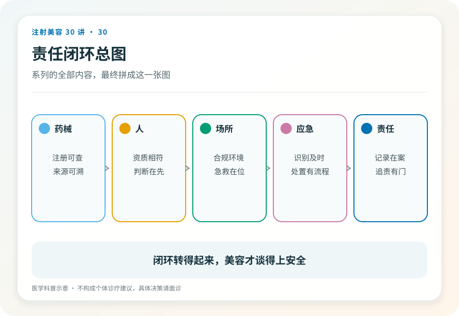
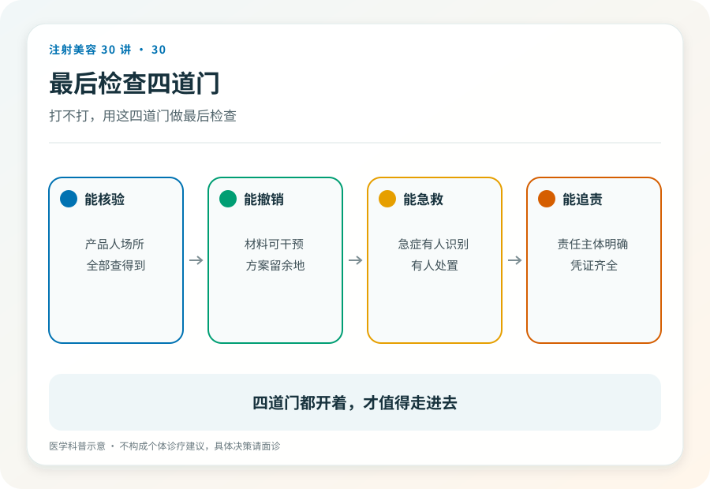

# 注射美容 30｜终章，注射美容的边界是四道门与一条链

> **视角｜全系列总纲** 本篇是专业篇，也是消费者可读的收束。四道门是本系列构造的认知工具，不是行业标准术语。

关于注射美容的安全，流行两种简化，它是技术问题（“找个手法好的”），或者它是运气问题（“出事的都是倒霉的”）。

前面 29 篇拆解的其实是同一个结构，安全不是某个环节的属性，而是一条链的完整性。终章负责把链条组装回去。

## 四道门

一次可以被辩护的美容注射，必须同时通过四道门。

**能核验。** 药械有注册身份（第 02、03、19、23 篇），机构、人员、场所有资质（第 05、22 篇）。消费者的动作是查证，从业者的义务是可被查证；把信息主动摆在能被检验的位置。

**能撤销。** 材料的可逆性被如实告知（第 04、16 篇），退出机制的边界被讲清（第 15 篇），不可逆选项匹配了更高的决策门槛。消费者的动作是先问退路再问效果，从业者的义务是不把“可溶解”当成免责话术。

**能急救。** 风险被完整告知（第 14 篇），识别、处置、转诊的体系真实存在（第 18 篇），术后的求助路径畅通（第 26 篇）。消费者的动作是记住急症信号，从业者的义务是让应急预案先于事故存在。

**能追责。** 记录完整（注射档案、病历、知情同意书），责任主体明确、找得到、赔得起（第 01、27 篇）。消费者的动作是留存证据，从业者的义务是把每一次操作做成可以被复盘的文档。

## “与门”逻辑

四道门是“与”的关系，不是“或”，任何一道不通过，其他三道再完美，这一针都不该打。

风险管理里最常见的失败，不是全无防备，而是用一道强门补偿另一道的缺失。“产品绝对是正品，所以工作室打也行”，第一道门补不了第三道；“医生技术很好，所以不用问应急预案”，技术不是急救体系的替代品；“机构很大很正规，所以不用留记录”，品牌不是证据。

链式失效是医美注射事故的主导模式，复盘公开报道的严重事件，几乎总能找到不止一道门的缺失，而当事人往往以为自己守住了“最重要的那道”。（这是基于事故报道的模式归纳，不是系统研究；如实标注。）

## 边界是动态的，门的结构不变

注册状态会变、新材料会来、监管会更新。这就是全系列反复出现“以当前公示为准”的原因。

四道门的内容需要当次核验，但结构不变，无论明年流行什么新名字的针，它依然要回答同样四个问题，能核验吗、能撤销吗、出事能急救吗、事后能追责吗。框架比清单耐用，这是本系列真正想交付的东西。

## 对从业者而言，门是行业的基础设施

对从业者，四道门不是合规成本，是这个行业能否继续被信任的基础设施。上报与记录在喂养行业的证据生态（第 11 篇），应急体系在兜住最坏的结局（第 18 篇），边界自查在保护你的执照（第 24 篇），拒绝的能力在证明评估真的存在（第 28 篇）。

每一个把门修好的从业者，都在替整个行业还“黑医美”欠下的信任债。

## 对消费者而言，最终武器是择期性

对消费者，全系列的立场收束成四句（均为明确标注的价值判断）。可核验优先于便宜，可逆优先于惊艳，能追责优先于熟人信任，不打永远是合法选项。

注射美容是择期项目，可以等，可以再问一个医生，可以永远不做。四道门检查不通过时，“不打”不是你的损失，而是这套系统正常工作的结果。它刚刚替你挡掉了一个不该冒的险。

## 证据边界

终章不引入新的医学主张，所有论断的证据基础见前 29 篇各自的证据边界。四道门与责任链条是本系列构造的认知工具，使用时不应冒充行业共识或监管术语。

延伸阅读

- [国家卫健委医疗美容服务管理相关文件](https://www.nhc.gov.cn/wjw/c100221/202201/d7e8fa33a26b425da98d69fb04191699.shtml)
- [Beleznay 2015 填充剂致盲世界文献回顾](https://pubmed.ncbi.nlm.nih.gov/26356847/)
- [Ho 2022 BoNT-A 耐药国际共识](https://pubmed.ncbi.nlm.nih.gov/35747253/)

**美容注射的最高技术不在针尖上，而在针尖之前的四道门里；门都开着的时候，那一针才轮得到技术说话。**
